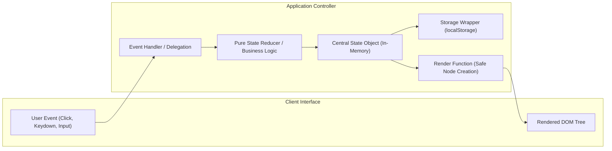

# System Architecture Specification: Day-02 Systems Suite

**Author:** Ronit Ahuja  
**Date:** Monday, 26 October 2026  
**Status:** Implemented & Verified  
**Runtime:** Modern Browsers (ES2020+ ES Modules) & Node.js 20+  
**Companion Spec:** [PRD.md](PRD.md)  

---

## 1. Architectural Principles

The Day-02 codebase follows five fundamental software engineering principles:

1. **State In, DOM Out (Unidirectional Data Flow)**:
   The DOM is never the source of truth. Every application maintains an in-memory `state` object. All UI interactions trigger event handlers that update the state, synchronize persistence, and invoke an idempotent `render(state)` function that projects the state onto the DOM.

2. **Decoupled Pure Logic**:
   Business logic (calculating streaks, shuffling decks, filtering cards, tokenizing keystrokes, formatting currency) is isolated into pure JavaScript functions. These functions take data, return new data, and never touch `document` or `window`. This makes the logic deterministic, bug-free, and straightforward to unit-test.

3. **Immutable State Transitions**:
   State objects and arrays are never mutated in place. All additions, deletions, updates, and sorts use non-mutating operations:
   - Array spread (`[...items]`) and object spread (`{ ...obj }`)
   - `map()` for updates
   - `filter()` for removals
   - Cloned arrays (`[...arr].sort()`) for sorting and shuffling

4. **Security Protocol: Zero Dynamic `innerHTML`**:
   To prevent Cross-Site Scripting (XSS) vulnerabilities, user-supplied text and dynamic API responses are injected strictly via `.textContent`. Dynamic elements are constructed imperatively using `document.createElement()`, configured, and appended. Static markup with no dynamic user input uses safe static nodes.

5. **Defensive LocalStorage Wrapper**:
   All storage access is mediated through defensive wrappers with isolated, versioned keys (`day2.habits.v1`, `day2.flashcards.v1`, `day2.typing.best.v1`). Any `JSON.parse` or `localStorage.setItem` errors (e.g., corrupted data, private browsing quota exceeded) are caught gracefully, falling back to starter defaults without crashing the application.

---

## 2. System Architecture & Component Flow

### 2.1 Unidirectional State $\rightarrow$ Render Pipeline



### 2.2 Application State Machines

#### A. JavaScript Flashcards (`projects/flashcards/`)
- **State Structure**:
  ```javascript
  const state = {
    deck: Array<Card>,          // Active cards [{ id, front, back, known }]
    originalOrder: Array<Card>, // Preserved order for Reset Order
    filter: 'all',              // 'all' | 'unknown' | 'known'
    index: 0,                   // Active card pointer
    flipped: false              // 3D flip orientation
  };
  ```
- **3D Flip Architecture**:
  The card component uses hardware-accelerated CSS 3D transforms:
  ```css
  .flashcard-scene {
    perspective: 1200px;
    height: 210px;
  }
  .flashcard-inner {
    transform-style: preserve-3d;
    transition: transform 0.55s cubic-bezier(0.2, 0.8, 0.2, 1);
    will-change: transform;
  }
  .flashcard-scene.is-flipped .flashcard-inner {
    transform: rotateY(180deg);
  }
  .card-face {
    backface-visibility: hidden;
    -webkit-backface-visibility: hidden;
    transform: translate3d(0, 0, 0);
  }
  .card-front { transform: rotateY(0deg); }
  .card-back { transform: rotateY(180deg); }
  ```
- **Fisher–Yates Shuffle Engine**:
  ```javascript
  export function shuffle(deck) {
    const copy = [...deck];
    for (let i = copy.length - 1; i > 0; i--) {
      const j = Math.floor(Math.random() * (i + 1));
      [copy[i], copy[j]] = [copy[j], copy[i]];
    }
    return copy;
  }
  ```

#### B. Daily Habit Tracker (`projects/habit-tracker/`)
- **State Structure**:
  ```javascript
  const state = {
    habits: Array<{
      id: string,
      name: string,
      createdAt: string,
      completedDays: Array<string> // Array of 'YYYY-MM-DD'
    }>
  };
  ```
- **Streak Calculation Engine**:
  Computes continuous streaks backwards using a `Set` for $O(1)$ daily lookups:
  ```mermaid
  flowchart TD
      Start["calculateStreaks(completedDays)"] --> SetCheck{"Is today completed?"}
      SetCheck -- Yes --> SetStartToday["checkDate = Today"]
      SetCheck -- No --> YesterdayCheck{"Is yesterday completed?"}
      YesterdayCheck -- Yes --> SetStartYesterday["checkDate = Yesterday"]
      YesterdayCheck -- No --> NoStreak["Current Streak = 0"]
      SetStartToday --> WhileLoop["While completedDays.has(checkDate)"]
      SetStartYesterday --> WhileLoop
      WhileLoop -- Match --> Increment["currentStreak++<br/>checkDate.setDate(checkDate - 1)"]
      Increment --> WhileLoop
      WhileLoop -- Miss --> Finalize["Return { currentStreak, longestStreak }"]
      NoStreak --> Finalize
  ```
- **Local Date Formatting**:
  To avoid UTC date rollover bugs caused by `Date.prototype.toISOString()`, local calendar dates are constructed strictly using local date getters:
  ```javascript
  export function formatLocalDate(date = new Date()) {
    const year = date.getFullYear();
    const month = String(date.getMonth() + 1).padStart(2, '0');
    const day = String(date.getDate()).padStart(2, '0');
    return `${year}-${month}-${day}`;
  }
  ```

#### C. Typing Speed Test (`projects/typing-test/`)
- **State Structure**:
  ```javascript
  const state = {
    passage: string,
    targetWords: Array<string>,
    currentIndex: 0,
    startTime: number | null,
    timerInterval: number | null,
    duration: 30 | 60,
    timeLeft: 30 | 60,
    isActive: false,
    isFinished: false,
    errors: 0,
    totalTyped: 0
  };
  ```
- **Telemetry & Metric Math**:
  - Net WPM accounts for uncorrected errors to penalize inaccurate speed:
    $$\text{Net WPM} = \max\left(0, \frac{(\text{Total Characters Typed} / 5) - \text{Errors}}{\text{Elapsed Time in Minutes}}\right)$$
  - Accuracy Percentage:
    $$\text{Accuracy} = \frac{\text{Total Characters} - \text{Errors}}{\text{Total Characters}} \times 100$$
- **Anti-Cheat Defense**:
  Paste events on the input area are captured and blocked:
  ```javascript
  elements.input.addEventListener('paste', (e) => e.preventDefault());
  ```

#### D. Pokédex Specimen Explorer (`projects/pokedex/`)
- **Dual Asynchronous Flow**:
  ```mermaid
  flowchart TD
      UserQuery["User Action"] --> RouteChoice{"Operation Type?"}
      RouteChoice -- Browse Catalog --> BulkFetch["Batch Query via Promise.all()<br/>https://pokeapi.co/api/v2/pokemon/${id}"]
      RouteChoice -- Specimen Search --> CacheCheck{"Specimen in Map cache?"}
      CacheCheck -- Cache Hit --> InstantRender["Instant Render (0ms latency)"]
      CacheCheck -- Cache Miss --> AsyncFetch["async/await targeted fetch<br/>try / catch / finally"]
      BulkFetch --> CachePopulate["Populate in-memory Map cache"]
      AsyncFetch --> CachePopulate
      CachePopulate --> StateRender["Update UI State (idle, loading, success, notFound, error)"]
      InstantRender --> StateRender
  ```
- **In-Memory Cache Layer**:
  Responses are indexed in a runtime `Map`:
  ```javascript
  const cache = new Map();
  export async function fetchPokemon(query) {
    const key = String(query).toLowerCase().trim();
    if (cache.has(key)) return cache.get(key);
    
    const res = await fetch(`https://pokeapi.co/api/v2/pokemon/${key}`);
    if (!res.ok) throw new Error(res.status === 404 ? 'NOT_FOUND' : 'NETWORK_ERROR');
    const data = await res.json();
    cache.set(key, data);
    return data;
  }
  ```

---

## 3. Design System & Viewport Ergonomics

### 3.1 Design Tokens

| Token Category | Token Variable | Value | Purpose |
|---|---|---|---|
| **Canvas** | `--color-canvas` | `#06070a` | Deep obsidian backdrop |
| **Surface** | `--color-surface` | `#0c1017` | Structural container elevation |
| **Card Background** | `--color-card-bg` | `#111622` | Raised element surface |
| **Borders** | `--color-border` | `rgba(255, 255, 255, 0.08)` | Subtle structural divider |
| **Borders Hover** | `--color-border-hover` | `rgba(255, 255, 255, 0.18)` | Interactive boundary highlight |
| **Accent Primary** | `--color-primary` | `#38bdf8` | Sky cyan focal points |
| **Accent Success** | `--color-success` | `#10b981` | Emerald completion indicator |
| **Accent Warning** | `--color-warning` | `#f59e0b` | Amber streaks and learning tags |
| **Accent Danger** | `--color-danger` | `#f43f5e` | Rose errors and destructive actions |
| **Display Font** | `--font-display` | `Space Grotesk`, sans-serif | Bold architectural headers |
| **Interface Font** | `--font-sans` | `Plus Jakarta Sans`, sans-serif | Clean legibility for controls |
| **Monospace Font** | `--font-mono` | `JetBrains Mono`, monospace | Metrics, numbers, code snippets |

### 3.2 Viewport Ergonomics & Laptop Fold Optimization

On standard 13" and 14" laptop screens (MacBook 13"/14", ThinkPad 14"), available vertical viewport height between browser toolbars and OS docks ranges from **600px to 750px**.

To eliminate the need for scrolling during core interactive workflows:
- **Body Padding**: Calibrated to `1.15rem`–`1.5rem` top padding (saving ~35px dead space).
- **Header Hierarchy**: Compressed header gap to `0.5rem`, locking title clamp to `clamp(1.6rem, 3.5vw, 2.1rem)` and subtitle to `0.92rem`.
- **Panel Spacing**:
  - `<main class="main-content">` explicitly declares `display: flex; flex-direction: column; gap: 1.15rem;` to prevent component crowding.
  - Controls bar padding calibrated to `0.65rem 0.95rem`.
- **Card Scene**: 3D card scene height locked to `210px` with `1.25rem 1.6rem` internal face padding.
- **Resulting Vertical Stack**:
  $$\text{Top Space (20px)} + \text{Header (60px)} + \text{Progress (50px)} + \text{Controls (48px)} + \text{Card (210px)} + \text{Actions (40px)} \approx 530\text{px}$$
  The entire interactive zone and action buttons (`Previous`, `Flip`, `Mark as Mastered`, `Next`) sit comfortably above the fold.

---

## 4. Repository Structure & File Layout

```
Day-02/
├── README.md                      # Entry point documentation & script runner commands
├── PRD.md                         # Product Requirements Document
├── ARCHITECTURE.md                # System Architecture Specification (This document)
├── package.json                   # Project metadata with ESM configuration
├── .gitignore                     # Git exclusions (.env, node_modules, OS files)
├── .prettierrc                    # Prettier formatting configuration
├── 01-fundamentals/               # Core JavaScript mechanics & ES6+ practice
│   ├── 01-variables-and-types.js
│   ├── 02-operators-conditionals-loops.js
│   ├── 03-functions.js
│   ├── 04-es6-features.js
│   └── modules-demo/
│       ├── index.html
│       ├── main.js
│       └── math.js
├── 02-array-methods/              # Algorithmic array transformations
│   ├── data.js
│   ├── exercises.js               # Exercises 1–21
│   └── object-manipulation.js     # Object operations
├── 03-dom-examples/               # Low-level DOM manipulation
│   ├── index.html
│   ├── style.css
│   └── dom-examples.js
├── 04-async-examples/             # Asynchronous execution & network handling
│   ├── 01-callbacks.js
│   ├── 02-promises.js
│   ├── 03-async-await.js
│   ├── 04-fetch-api.js
│   └── 05-error-handling.js
└── projects/
    ├── index.html                 # Central Showcase Hub
    ├── flashcards/                # 3D JavaScript Flashcards
    │   ├── index.html
    │   ├── style.css
    │   ├── README.md
    │   └── js/ (deck.js, storage.js, ui.js, main.js)
    ├── habit-tracker/             # Daily Habit Tracker
    │   ├── index.html
    │   ├── style.css
    │   ├── README.md
    │   └── js/ (dates.js, streaks.js, state.js, storage.js, stats.js, ui.js, main.js)
    ├── typing-test/               # Typing Speed Test
    │   ├── index.html
    │   ├── style.css
    │   ├── script.js
    │   └── README.md
    └── pokedex/                   # Pokédex Specimen Explorer
        ├── index.html
        ├── style.css
        ├── README.md
        └── js/ (api.js, ui.js, main.js)
```

---

## 5. Automated Verification & Test Commands

Every component in the repository is independently verifiable without external dependencies:

```bash
# Verify Core Fundamentals
node 01-fundamentals/01-variables-and-types.js
node 01-fundamentals/02-operators-conditionals-loops.js
node 01-fundamentals/03-functions.js
node 01-fundamentals/04-es6-features.js

# Verify Array & Object Manipulations
node 02-array-methods/exercises.js
node 02-array-methods/object-manipulation.js

# Verify Asynchronous Programming & Network Operations
node 04-async-examples/01-callbacks.js
node 04-async-examples/02-promises.js
node 04-async-examples/03-async-await.js
node 04-async-examples/04-fetch-api.js
node 04-async-examples/05-error-handling.js
```

All 5 web endpoints serve cleanly over a local static HTTP server (e.g., Live Server on port 5500):
- Portfolio Hub: `http://localhost:5500/projects/index.html`
- Flashcards: `http://localhost:5500/projects/flashcards/index.html`
- Habit Tracker: `http://localhost:5500/projects/habit-tracker/index.html`
- Typing Test: `http://localhost:5500/projects/typing-test/index.html`
- Pokédex: `http://localhost:5500/projects/pokedex/index.html`
