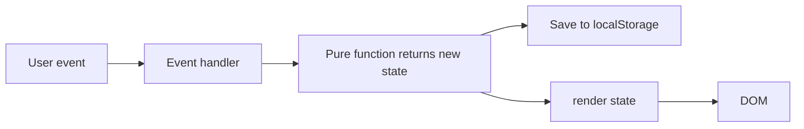
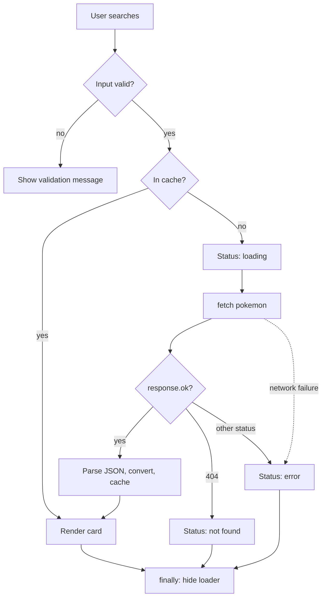

# Architecture: Day 2 – JavaScript Fundamentals & ES6+

Companion to `PRD.md`. IDs such as `HT-3` or `PK-4` refer to requirements there.

## 1. Principles

1. **State in, DOM out.** Each app keeps one state object. Event handlers update state, save it, then call `render`. The DOM is never the source of truth.
2. **Pure logic, separate from the DOM.** Functions that compute streaks, filter decks or shuffle arrays take data and return data. They never touch `document`, so they are easy to explain and test.
3. **Immutable updates.** Use spread, `map` and `filter` to return new arrays and objects. Never mutate state in place. Copy before `sort` or shuffle.
4. **No frameworks, no build step.** Plain HTML, CSS and JavaScript, served by Live Server.
5. **One job per file.** Small modules with clear exports.

## 2. Tech stack

| Layer | Choice |
|---|---|
| Markup | HTML5, semantic elements |
| Styling | CSS3, mobile-first (`min-width` queries), CSS custom properties |
| Language | JavaScript (ES2020+), ES modules where noted |
| Runtime for practice scripts | Node 20 (`node file.js`, global `fetch`) |
| Dev server | VS Code Live Server (port 5500) |
| Formatting | Prettier (`semi: true`, `singleQuote: true`, `tabWidth: 2`) |
| Storage | `localStorage` (JSON) |
| External API | PokeAPI (no key), JSONPlaceholder (no key) |

## 3. Repository layout

```
Linkific-Tasks/
└── Day-02/
    ├── README.md                      Concepts learned, concept → file table, screenshots
    ├── package.json                   Optional: { "private": true, "type": "module" }
    ├── .gitignore                     .DS_Store, node_modules/, .env
    ├── .prettierrc
    ├── docs/
    │   ├── PRD.md
    │   ├── ARCHITECTURE.md
    │   ├── SUCCESS_MATRIX.md
    │   ├── GUIDELINES.md
    │   └── FACTS.md                   Generated at M9: what is actually implemented
    ├── 01-fundamentals/
    │   ├── 01-variables-and-types.js
    │   ├── 02-operators-conditionals-loops.js
    │   ├── 03-functions.js
    │   ├── 04-es6-features.js
    │   └── modules-demo/              index.html, math.js, main.js
    ├── 02-array-methods/
    │   ├── data.js                    Shared sample data (users, products, marks)
    │   ├── exercises.js               Exercises 1–21
    │   └── object-manipulation.js     O1–O3
    ├── 03-dom-examples/               index.html, style.css, dom-examples.js
    ├── 04-async-examples/
    │   ├── 01-callbacks.js
    │   ├── 02-promises.js
    │   ├── 03-async-await.js
    │   ├── 04-fetch-api.js
    │   └── 05-error-handling.js
    └── projects/
        ├── index.html                 Optional hub page linking all four
        ├── habit-tracker/             index.html, style.css, js/ (7 modules), screenshots/, README.md
        ├── typing-test/               index.html, style.css, script.js, screenshots/, README.md
        ├── pokedex/                   index.html, style.css, js/ (3 modules), screenshots/, README.md
        └── flashcards/                index.html, style.css, js/ (4 modules), screenshots/, README.md
```

Each project folder works on its own, so it can be opened and demoed alone. `type="module"` scripts are used in Habit Tracker, Pokédex and Flashcards. Typing Test uses a classic script, so both styles appear.

## 4. Cross-cutting patterns

### 4.1 State → render loop



- Attach listeners once, in `main.js`. For dynamic lists, use **event delegation** on the parent and read `event.target.closest('[data-id]')`.
- `render` rebuilds the changed region from state. User-provided text is set with `textContent`. Only static markup with no user data may use `innerHTML` or template strings.

### 4.2 Storage wrapper (Habit Tracker and Flashcards)

```
load(key, fallback)   → parsed value, or fallback if missing, corrupt or storage is blocked
save(key, value)      → true on success, false on failure (never throws)
```

- Keys are namespaced and versioned: `day2.habits.v1`, `day2.flashcards.v1`, `day2.typing.best.v1`.
- Both functions wrap `JSON.parse` and `setItem` in `try/catch`.

### 4.3 Error and status messages

- Every async or storage operation has a visible failure state. Never fail silently into the console.
- Status text lives in an element with `role="status"` or `aria-live="polite"`.

### 4.4 CSS conventions

- Base styles target mobile. Add `@media (min-width: 768px)` and `@media (min-width: 1024px)` for larger screens.
- Colours, spacing and radii are CSS custom properties on `:root`.
- Section comments such as `/* ===== Layout ===== */`. No `!important`. `box-sizing: border-box` globally.
- Animations (card flip, progress bars) are wrapped for `prefers-reduced-motion`.

## 5. Project architectures

### 5.1 Habit Tracker

```
habit-tracker/js/
├── main.js      Entry. Loads state, wires events, calls render
├── state.js     Pure updates on the habits array
├── storage.js   load/save for 'day2.habits.v1'
├── dates.js     Local date helpers
├── streaks.js   Pure streak calculations
├── stats.js     Pure aggregates for the stats panel
└── ui.js        DOM rendering only
```

**State**
```js
{
  habits: [{ id: 'h_1', name: 'Read 20 pages', createdAt: '2026-10-26', checkIns: ['2026-10-25', '2026-10-26'] }],
  message: ''   // validation or status text
}
```

**Module contracts**

| Module | Export | Behaviour | Concepts |
|---|---|---|---|
| `dates.js` | `toDateKey(date = new Date())` | Local `YYYY-MM-DD` using `getFullYear/getMonth/getDate`, zero-padded. Not `toISOString()` (that is UTC and shifts the day) | default parameter, template literal |
| `dates.js` | `addDays(key, n)` | Returns the date key `n` days away, using local date components | |
| `streaks.js` | `getCurrentStreak(checkIns, todayKey)` | Walk back one day at a time from today (or yesterday if today is unchecked) while the date is in a `Set` | `while`, `Set` |
| `streaks.js` | `getLongestStreak(checkIns)` | Sort unique dates, count runs of consecutive days, return the maximum | `sort` on a copy, `for...of` |
| `streaks.js` | `isDoneOn(checkIns, key)` | `checkIns.some(...)` or `includes` | `some` |
| `state.js` | `addHabit(habits, name)` | Validates (HT-1) and returns `{ habits, error }` with a new array | spread, destructuring |
| `state.js` | `toggleCheckIn(habits, id, key)` | Returns a new array; adds or removes the date, keeps it sorted and unique | `map`, spread |
| `state.js` | `deleteHabit(habits, id)` | `filter` | `filter` |
| `state.js` | `findHabit(habits, id)` | `find` | `find` |
| `stats.js` | `getTotalCheckIns(habits)` | `reduce` | `reduce` |
| `stats.js` | `rankByStreak(habits, todayKey)` | Sorts a copy by current streak, descending | `sort`, `map` |
| `stats.js` | `checkInsByDate(habits)` | `reduce` into `{ [date]: count }` | computed property names |
| `ui.js` | `renderHabits`, `renderStats`, `showMessage` | Build rows with `createElement`, set text with `textContent`; the stats object is shown with `Object.entries` (and one `for...in` somewhere deliberate) | DOM, `Object.entries` |

**Streak algorithm (pseudo-code)**
```
currentStreak(checkIns, today):
  days = new Set(checkIns)
  cursor = days.has(today) ? today : addDays(today, -1)
  count = 0
  while days.has(cursor): count++; cursor = addDays(cursor, -1)
  return count

longestStreak(checkIns):
  sorted = [...new Set(checkIns)].sort()
  best = 0; run = 0; prev = null
  for date of sorted:
    run = (prev && addDays(prev, 1) === date) ? run + 1 : 1
    best = max(best, run); prev = date
  return best
```

**Edge cases to handle:** empty `checkIns`; unchecking today; duplicate habit names with different casing; month and year boundaries; corrupted storage.

### 5.2 Typing Speed Test

```
typing-test/
├── index.html
├── style.css
└── script.js     Classic script: constants, state, pure helpers, handlers, init
```

**State**
```js
{ status: 'idle' | 'running' | 'finished', level: 'easy', duration: 30,
  target: '', typed: '', secondsLeft: 30, startedAt: null, timerId: null }
```

| Function | Behaviour | Concepts |
|---|---|---|
| `pickText(level)` | `switch (level)` selects the pool, then returns a random item | `switch`, array indexing |
| `startTimer()` | Called on the first `input` event only. `setInterval` calls `tick` each second | callback |
| `tick()` | Decrements `secondsLeft`; calls `finishTest()` at 0 | |
| `handleInput(event)` | Updates `typed`; starts the timer if idle; finishes if the passage is complete | `input` event |
| `renderChars(target, typed)` | `target.split('').map(...)` builds one `<span>` per character with a `correct`, `incorrect` or `pending` class; the next character gets `current` | `map`, `classList` |
| `computeResults(target, typed, secondsElapsed)` | Counts correct characters with `reduce` or `for...of`; returns `{ wpm, accuracy, errors }` | `reduce`, destructuring |
| `finishTest()` | `clearInterval`, set status, disable input, show results | |
| `resetTest()` | Clear interval, reset state and DOM, pick a new text | |

Guard against: a second timer starting, negative or zero elapsed time (use at least 1 second in the WPM formula), and division by zero in accuracy.

### 5.3 Pokédex

```
pokedex/js/
├── main.js   Entry: state, events, orchestration of the two async styles
├── api.js    Network layer, no DOM
└── ui.js     Rendering, no network
```

**State**
```js
{ status: 'idle' | 'loading' | 'success' | 'notFound' | 'error',
  current: null,        // one view-model, or null
  list: [], offset: 0, typeFilter: 'all', sortBy: 'id', message: '' }
```

**`api.js` contracts**

| Export | Behaviour |
|---|---|
| `fetchJson(url)` | `await fetch(url)`; if `!response.ok`, throw an `Error` carrying `status`; otherwise return `await response.json()` |
| `getPokemon(nameOrId)` (async) | Normalises the key, checks the `Map` cache, calls `fetchJson`, converts with `toPokemonView`, stores in the cache |
| `getPokemonPage(offset, limit)` | Returns a **promise** for the list endpoint's `results`, so `main.js` can chain it |
| `toPokemonView(raw)` | Nested destructuring into `{ id, name, sprite, types, heightM, weightKg, stats }`. Height is decimetres and weight is hectograms in the API, so divide by 10 |

**The two async styles in `main.js`**
```js
// Browse (PK-3): a promise chain, on purpose
getPokemonPage(offset, 20)
  .then(items => Promise.all(items.map(item => getPokemon(item.name))))
  .then(addToList)
  .catch(showError)
  .finally(hideLoader);

// Search (PK-4): async/await, on purpose
async function handleSearch(query) {
  setStatus('loading');
  try { showPokemon(await getPokemon(query)); }
  catch (error) { setStatus(error.status === 404 ? 'notFound' : 'error'); }
  finally { hideLoader(); }
}
```



Guard against: stale responses (a slow earlier request finishing after a newer one; ignore results that do not match the latest query), an empty search, double-clicking "Load more", and images that fail to load (`alt` text plus a fallback).

### 5.4 Flashcards

```
flashcards/js/
├── main.js      Entry: state, events
├── deck.js      Pure deck logic, no DOM
├── storage.js   load/save for 'day2.flashcards.v1'
└── ui.js        Rendering
```

**State**
```js
{ deck: [{ id: 'c_1', front: 'What does const prevent?', back: 'Reassignment of the binding', known: false }],
  filter: 'all' | 'known' | 'unknown', index: 0, flipped: false, message: '' }
```

| Function (`deck.js`) | Behaviour | Concepts |
|---|---|---|
| `STARTER_DECK` | At least 10 cards | |
| `createCard(front, back)` | Validates; returns a new card with a generated id | default parameters, object shorthand |
| `toggleKnown(deck, id)` | `map` returning `{ ...card, known: !card.known }` for the match | spread, `map` |
| `filterDeck(deck, mode)` | `filter` by `known` | `filter` |
| `shuffle(deck)` | Copies with `[...deck]`, then Fisher–Yates. Do **not** use `sort(() => Math.random() - 0.5)` because it is biased | spread, loops |
| `getProgress(deck)` | `{ known, total, allKnown }` using `filter` and `every` | `filter`, `every`, destructuring |
| `removeCard(deck, id)` | `filter` | |

After a filter or delete, clamp `index` so it never points past the end. Flip uses `classList.toggle('is-flipped')`.

## 6. Practice folders

| Folder | How it runs | Convention |
|---|---|---|
| `01-fundamentals/*.js` | `node 01-fundamentals/<file>.js` | Each section starts with a comment header and logs its output |
| `02-array-methods/exercises.js` | `node 02-array-methods/exercises.js` | `// Exercise N: title`, a prompt comment, the solution, `console.log` or `console.table`, then `// Expected: ...` |
| `03-dom-examples/` | Live Server | Six sections, each with a heading and a short "what this shows" line |
| `04-async-examples/*.js` | `node 04-async-examples/<file>.js` | Each file prints a labelled step-by-step trace; uses public no-key APIs |

## 7. Verification approach

- **Manual:** run each project on Live Server, test the Must requirements, check DevTools Console for errors, resize to 375, 768 and 1280 px, and tab through with the keyboard.
- **Commands:** the grep and git checks in `SUCCESS_MATRIX.md`.
- **Optional unit tests:** with `"type": "module"` in `package.json`, `node --test` can run small tests against `streaks.js`, `dates.js` and `deck.js` because they are pure.
