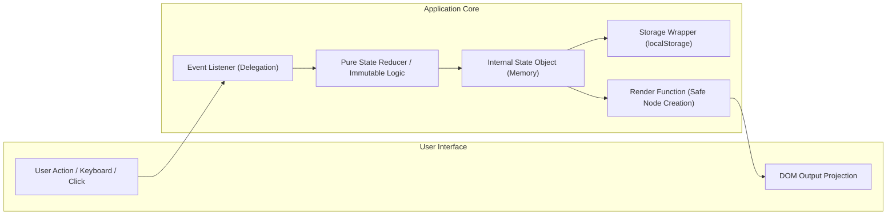
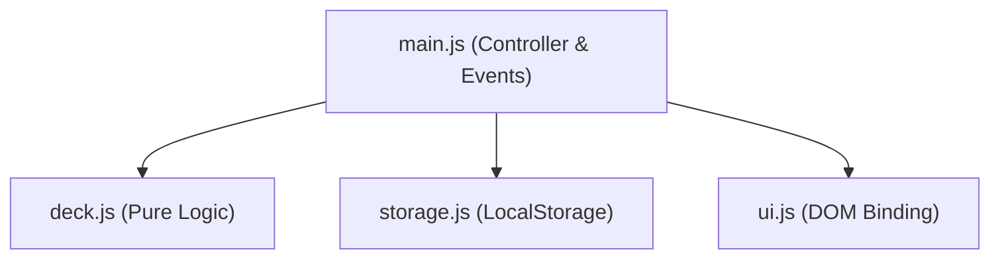

# Day-02 Product Requirements & System Architecture Specification

**Project:** Modern Vanilla JavaScript Systems Suite & Core Curriculum  
**Author:** Ronit Ahuja  
**Status:** Implemented & Verified  
**Runtime Environment:** Modern Web Browsers (ES2020+ ES Modules) & Node.js 20+  
**Stack:** Vanilla HTML5, CSS3 (Custom Properties & 3D Transforms), Modern Vanilla JavaScript (ES Modules)  
**Security Standard:** Strict Zero Dynamic `innerHTML` Injection Policy  

---

## 1. Executive Summary & Purpose

The Day-02 engineering suite represents an end-to-end mastery of modern Vanilla JavaScript without reliance on third-party frameworks, bundlers, or UI component libraries. The system is architected into two core pillars:

1. **Foundational JavaScript Curriculum (`01`–`04`)**:
   - Deep algorithmic understanding of scope, hoisting, closures, prototypal mechanics, and ES6+ features.
   - 21 discrete array transformation exercises and object mutation mechanics.
   - Direct, low-level Document Object Model (DOM) manipulation and event delegation patterns.
   - Complete asynchronous programming patterns: Callbacks, Promises, `Promise.all` concurrency, `async/await`, and network failure handling.

2. **Flagship Web Application Suite (`projects/`)**:
   - Four distinct, interactive web applications demonstrating unidirectional state flow, immutable state machines, local storage persistence, responsive ergonomics, and tactile 3D CSS rendering:
     - **JavaScript Flashcards**: 3D spatial flip deck with Fisher–Yates shuffling and mastery categorization.
     - **Daily Habit Tracker**: Streak calculation engine with local date arithmetic and a 7-day activity matrix.
     - **Typing Speed Test**: Sub-millisecond keystroke telemetry, real-time Net WPM calculation, and anti-cheat clipboard defense.
     - **Pokédex Specimen Explorer**: Asynchronous PokeAPI integration with in-memory `Map` caching and specimen stat analytics.

---

## 2. Architectural Principles & System Design Patterns

### 2.1 Unidirectional State $\rightarrow$ Render Pipeline

All client-side applications strictly enforce a unidirectional data flow. The DOM is strictly treated as an output projection of the internal JavaScript state, never the source of truth.



- **Single Source of Truth**: Each application maintains a centralized, single `state` object.
- **Pure Functional Logic**: Business logic (streak counting, deck filtering, WPM calculation) is encapsulated in pure functions that take data and return new data without mutating arguments or querying the DOM.
- **Immutable Updates**: State transitions utilize array spreads (`[...arr]`), object spreads (`{ ...obj }`), `map()`, and `filter()`. State is never mutated in place.

### 2.2 Security Protocol: Zero Dynamic `innerHTML`

To eliminate Cross-Site Scripting (XSS) vectors and DOM-based injection vulnerabilities:
- **Mandatory `textContent` Rule**: All user-provided strings, dynamic numbers, and external API responses are assigned strictly via `element.textContent`.
- **Imperative Node Construction**: Dynamic lists (e.g., habit rows, typing words, flashcards) are constructed using `document.createElement()`, `classList.add()`, and `appendChild()`.
- **Safe Static Partials**: Template strings with `innerHTML` are prohibited for dynamic user inputs and restricted exclusively to static, developer-controlled SVG icons.

### 2.3 Resilient LocalStorage Architecture

Data persistence operates through defensive serialization wrappers:
```javascript
export function loadFromStorage(key, fallback) {
  try {
    const raw = localStorage.getItem(key);
    return raw ? JSON.parse(raw) : fallback;
  } catch (err) {
    console.warn(`[Storage] Failed to read ${key}, using fallback:`, err);
    return fallback;
  }
}

export function saveToStorage(key, data) {
  try {
    localStorage.setItem(key, JSON.stringify(data));
    return true;
  } catch (err) {
    console.error(`[Storage] Write quota exceeded for ${key}:`, err);
    return false;
  }
}
```
- **Isolated Namespaces**: Keys are explicitly versioned (`day2.habits.v1`, `day2.flashcards.v1`, `day2.typing.best.v1`).
- **Quota & Parsing Failure Recovery**: Corrupted JSON or disabled cookies/storage automatically fall back to starter datasets without throwing runtime exceptions.

---

## 3. Directory Layout & Module Structure

```
Day-02/
├── README.md                      # Comprehensive suite documentation & run instructions
├── package.json                   # Project metadata with ESM configuration
├── .gitignore                     # Exclusion rules (node_modules, .env, OS artifacts)
├── .prettierrc                    # Code formatting configuration
├── docs/
│   ├── PRD_ARCHITECTURE.md        # Unified Product Requirements & Architecture (This document)
│   ├── PRD.md                     # Traceability matrix and requirement IDs
│   ├── ARCHITECTURE.md            # Structural architectural standards
│   ├── FACTS.md                   # Machine-verified implementation evidence
│   └── SUCCESS_MATRIX.md          # Acceptance criteria verification
├── 01-fundamentals/               # Core JavaScript syntax and ES6+ features
│   ├── 01-variables-and-types.js  # Scope, hoisting, data types, type coercion
│   ├── 02-operators-conditionals-loops.js # Control flow, loops, switch statements
│   ├── 03-functions.js            # Function declarations, arrows, callbacks, rest/defaults
│   ├── 04-es6-features.js         # Destructuring, spread/rest, computed properties
│   └── modules-demo/              # Native ES Module import/export runtime demo
├── 02-array-methods/              # Algorithmic data transformations
│   ├── data.js                    # Mock datasets (users, catalog, academic scores)
│   ├── exercises.js               # Exercises 1–21 (map, filter, reduce, sort, find)
│   └── object-manipulation.js     # Object.keys, values, entries, immutability
├── 03-dom-examples/               # Browser DOM manipulation suite
│   ├── index.html                 # Interactive DOM test harness
│   ├── style.css                  # DOM demonstration stylesheet
│   └── dom-examples.js            # Node creation, class manipulation, event listeners
├── 04-async-examples/             # Asynchronous control flow
│   ├── 01-callbacks.js            # Callback sequences and asynchronous inversion
│   ├── 02-promises.js             # Promise construction, resolution, reject chains
│   ├── 03-async-await.js          # Synchronous syntactic sugar over Promises
│   ├── 04-fetch-api.js            # HTTP requests and response parsing
│   └── 05-error-handling.js       # Network timeouts, 404/500 HTTP status defense
└── projects/
    ├── index.html                 # Unified Portfolio Hub (Interactive Launchpad)
    ├── flashcards/                # Application 1: 3D JavaScript Flashcards
    │   ├── index.html
    │   ├── style.css
    │   ├── README.md
    │   └── js/ (deck.js, storage.js, ui.js, main.js)
    ├── habit-tracker/             # Application 2: Daily Habit Tracker
    │   ├── index.html
    │   ├── style.css
    │   ├── README.md
    │   └── js/ (dates.js, streaks.js, state.js, storage.js, stats.js, ui.js, main.js)
    ├── typing-test/               # Application 3: Typing Speed Test
    │   ├── index.html
    │   ├── style.css
    │   ├── script.js
    │   └── README.md
    └── pokedex/                   # Application 4: Pokédex Specimen Explorer
        ├── index.html
        ├── style.css
        ├── README.md
        └── js/ (api.js, ui.js, main.js)
```

---

## 4. Application Functional Specifications

### 4.1 Application 1: JavaScript Flashcards (`projects/flashcards/`)

#### Purpose & Scope
An interactive, spatial memory retention console allowing engineers to test their grasp of JavaScript core mechanisms (event loop, prototypes, closures, hoisting).

#### Key Specifications & Requirements
- **FC-1 (Starter Deck)**: Pre-loaded with 12 structured architectural flashcards covering ES6, async execution, scope, and array methods.
- **FC-2 (3D Card Engine)**:
  - Perspective-based 3D flip card utilizing CSS `perspective: 1200px`, `transform-style: preserve-3d`, and `rotateY(180deg)`.
  - Backface culling (`backface-visibility: hidden`) without WebKit clipping artifacts.
- **FC-3 (Mastery State)**: Independent mastery tracking (`known: boolean`) per card. Marking a card updates memory and localStorage immutably.
- **FC-4 (Filter System)**: Dynamic deck filtering across `All Cards`, `To Learn`, and `Mastered` with live counter badges.
- **FC-5 (Fisher–Yates Shuffle)**: True uniform unbiased array permutation (`O(n)`) operating on a clone of the deck array. "Reset Order" restores the initial array layout.
- **FC-6 (Custom Card Authoring)**: Validated input form enabling users to append custom flashcards into the active deck.
- **FC-7 (Keyboard Navigation)**: Full keyboard accessibility: <kbd>Space</kbd> flips the card; <kbd>&larr;</kbd> and <kbd>&rarr;</kbd> navigate between cards.
- **FC-8 (Viewport Ergonomics)**: Compact vertical hierarchy ensuring the card scene (210px) and primary action controls remain above the fold on compact laptop viewports.

#### Module Dependency Graph


---

### 4.2 Application 2: Daily Habit Tracker (`projects/habit-tracker/`)

#### Purpose & Scope
A productivity console engineered to build momentum and consistency, featuring streak analytics and historical check-in visualization.

#### Key Specifications & Requirements
- **HT-1 (Habit Creation & Validation)**: Text input with strict length constraints (1–40 characters), trimming, and case-insensitive duplication prevention.
- **HT-2 (Daily Toggle)**: One-click completion status for the current calendar date (`YYYY-MM-DD`).
- **HT-3 (Streak Engine)**:
  - Continuous backward date traversal algorithm using `while` loop and `Set` lookups.
  - Distinguishes between **Current Streak** (inclusive of today or unbroken from yesterday) and **Longest Streak** (historical maximum).
- **HT-4 (Timezone-Safe Date Formatting)**: Strict local date extraction (`getFullYear()`, `getMonth() + 1`, `getDate()`) avoiding `toISOString()` UTC rollover bugs.
- **HT-5 (7-Day Visual Matrix)**: Displays a horizontal dot matrix reflecting completion status over the last 7 calendar days.
- **HT-6 (Productivity Stats)**: High-level analytics aggregating total completions across all habits and streak leaderboard rankings.
- **HT-7 (Immutable Deletion)**: Deletion filtered immutably through `habits.filter(h => h.id !== targetId)` and persisted immediately.

#### Streak Calculation Algorithm
```javascript
export function calculateStreaks(completedDaysSet, todayStr, yesterdayStr) {
  let currentStreak = 0;
  let checkDate = completedDaysSet.has(todayStr) 
    ? new Date() 
    : (completedDaysSet.has(yesterdayStr) ? getYesterdayDate() : null);

  if (checkDate) {
    while (completedDaysSet.has(formatLocalDate(checkDate))) {
      currentStreak++;
      checkDate.setDate(checkDate.getDate() - 1);
    }
  }
  // Historical maximum streak calculated via sorted timestamp scanning
  return { currentStreak, longestStreak };
}
```

---

### 4.3 Application 3: Typing Speed Test (`projects/typing-test/`)

#### Purpose & Scope
A latency-free terminal-grade typing test measuring Net Words Per Minute (WPM), accuracy percentage, and keystroke errors against engineering passages.

#### Key Specifications & Requirements
- **TT-1 (Technical Passages)**: 12 curated software engineering passages spanning algorithms, clean architecture, and asynchronous runtimes across 3 difficulty tiers (`Easy`, `Medium`, `Hard`).
- **TT-2 (First-Keystroke Activation)**: Timer is primed on page load but begins counting only upon the user's initial keystroke, preventing premature countdowns.
- **TT-3 (Per-Character Tokenizer)**: Real-time DOM span evaluation tagging characters with dynamic styling:
  - `.char-correct`: Typed character matches target.
  - `.char-incorrect`: Character mismatch.
  - `.char-current`: Active cursor index highlighting.
  - `.char-pending`: Untyped characters.
- **TT-4 (Net WPM Formula)**:
  $$\text{Net WPM} = \max\left(0, \frac{(\text{Total Characters Typed} / 5) - \text{Uncorrected Errors}}{\text{Time Elapsed (Minutes)}}\right)$$
- **TT-5 (Anti-Cheat & Paste Prevention)**: Clipboard paste events (`paste`) on the input field are explicitly blocked via `e.preventDefault()`.
- **TT-6 (Persistent High Scores)**: Personal best Net WPM score is stored in `localStorage` under `day2.typing.best.v1` and reflected in the UI HUD.

---

### 4.4 Application 4: Pokédex Specimen Explorer (`projects/pokedex/`)

#### Purpose & Scope
A high-craft biological encyclopedia interfacing directly with the public PokéAPI, demonstrating dual asynchronous programming strategies and client-side caching.

#### Key Specifications & Requirements
- **PK-1 (Dual Asynchronous Architectures)**:
  - **Batch Catalog Browsing**: Leverages `Promise.all()` over indexed resource endpoints (`https://pokeapi.co/api/v2/pokemon/${id}`) with `.then()` promise chains.
  - **Direct Specimen Search**: Leverages `async/await` with `try / catch / finally` for targeted name and ID lookups.
- **PK-2 (In-Memory `Map` Caching)**: Network responses are indexed in an in-memory `Map` (`cache.set(query, data)`). Identical queries resolve with zero network latency.
- **PK-3 (Five Distinct UI States)**:
  - `idle`: Initial landing view with featured specimens.
  - `loading`: Visual indeterminate shimmer state during network transit.
  - `success`: Rich rendering of official high-resolution artwork, types, measurements, and base stats.
  - `notFound`: Informative 404 message when a queried creature does not exist.
  - `error`: Network offline / API unreachable alert banner.
- **PK-4 (Event Delegation Grid)**: Interactive Pokémon specimen cards attach a single listener on `#pokemon-grid`, reading `event.target.closest('[data-id]')`.
- **PK-5 (Interactive Visual Base Stats)**: Visual progress bars mapping base stats (HP, Attack, Defense, Special Attack, Special Defense, Speed) against maximum values.

---

## 5. Design System & Frontend Architecture

The visual identity across all applications follows a strict, high-craft design language avoiding common generic templates.

### 5.1 Design Tokens

| Token Category | Variable Name | Value | Purpose |
|---|---|---|---|
| **Canvas** | `--color-canvas` | `#06070a` | Deep obsidian background |
| **Surface** | `--color-surface` | `#0c1017` | Secondary application container |
| **Card Background** | `--color-card-bg` | `#111622` | Component card elevation |
| **Borders** | `--color-border` | `rgba(255, 255, 255, 0.08)` | Subtle structural separators |
| **Accent Primary** | `--color-primary` | `#38bdf8` | Sky cyan for primary focal points |
| **Accent Success** | `--color-success` | `#10b981` | Emerald for mastery and completions |
| **Accent Warning** | `--color-warning` | `#f59e0b` | Amber for study states and streaks |
| **Accent Danger** | `--color-danger` | `#f43f5e` | Rose for deletions and typing errors |
| **Display Font** | `--font-display` | `Space Grotesk`, sans-serif | Expressive architectural headers |
| **Interface Font** | `--font-sans` | `Plus Jakarta Sans`, sans-serif | High-legibility UI typography |
| **Monospace Font** | `--font-mono` | `JetBrains Mono`, monospace | Metrics, telemetry, and code blocks |

### 5.2 Viewport Ergonomics & Layout Optimization
- **Laptop Fold Optimization**: Body padding calibrated to `1.15rem`–`1.5rem` and section gaps locked to `0.85rem`–`1.35rem`, ensuring that cards, interactive controls, and navigation buttons fit cleanly on 13"/14" laptop screens (650px–800px viewport height).
- **Proportional Micro-Interactions**: Hover lifts (`translateY(-1px)`), active depressions (`translateY(1px)`), and focused accessibility rings (`outline: 2px solid var(--color-primary)`).

---

## 6. Verification, Testing & Deliverables Matrix

### 6.1 Automated Verification Commands

All fundamental and algorithmic curriculum files execute cleanly with Node.js 20+:

```bash
# 1. Verify JavaScript Fundamentals
node 01-fundamentals/01-variables-and-types.js
node 01-fundamentals/02-operators-conditionals-loops.js
node 01-fundamentals/03-functions.js
node 01-fundamentals/04-es6-features.js

# 2. Verify Array Transformations & Object Manipulation (21 exercises)
node 02-array-methods/exercises.js
node 02-array-methods/object-manipulation.js

# 3. Verify Asynchronous Control Flow
node 04-async-examples/01-callbacks.js
node 04-async-examples/02-promises.js
node 04-async-examples/03-async-await.js
node 04-async-examples/04-fetch-api.js
node 04-async-examples/05-error-handling.js
```

### 6.2 Browser Runtime Verification

When hosted on an HTTP server (e.g., Live Server on port 5500), all 5 web entry points resolve with HTTP 200 and zero console errors:
- Portfolio Hub: `http://localhost:5500/projects/index.html`
- JavaScript Flashcards: `http://localhost:5500/projects/flashcards/index.html`
- Daily Habit Tracker: `http://localhost:5500/projects/habit-tracker/index.html`
- Typing Speed Test: `http://localhost:5500/projects/typing-test/index.html`
- Pokédex Explorer: `http://localhost:5500/projects/pokedex/index.html`

### 6.3 Security & Quality Audit Checklist
- [x] **0 `.env` or sensitive API keys** committed in the codebase.
- [x] **0 `.DS_Store` or OS artifacts** in git tracking.
- [x] **0 Dynamic `innerHTML`** calls handling external or user-provided data.
- [x] **0 Framework dependencies**: Pure native ES2020+ ES Modules and Vanilla CSS.
- [x] **0 Lint Failures**: Strict compliance with modern frontend architectural guidelines.
