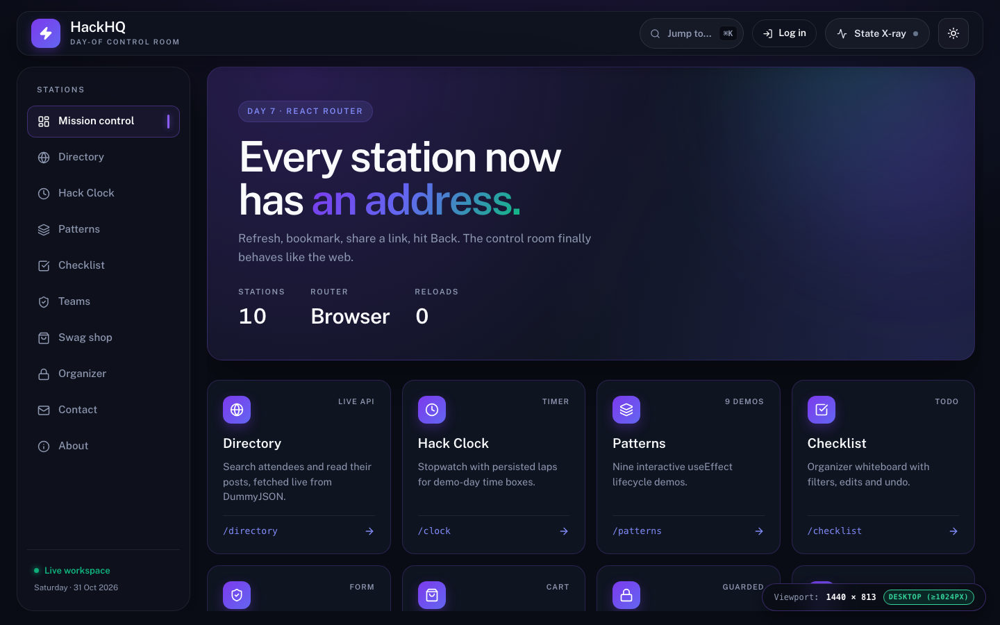
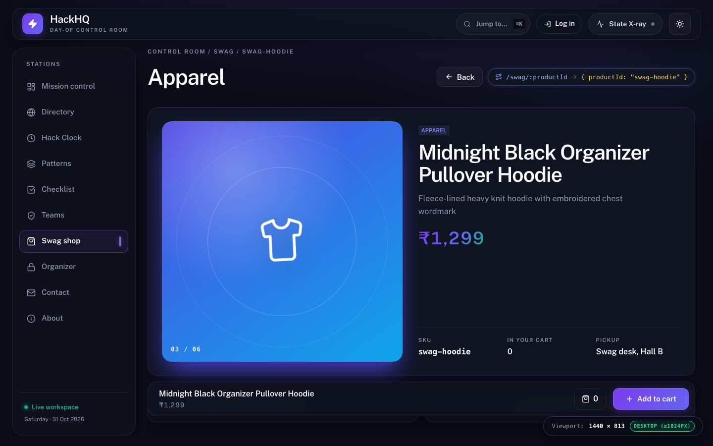
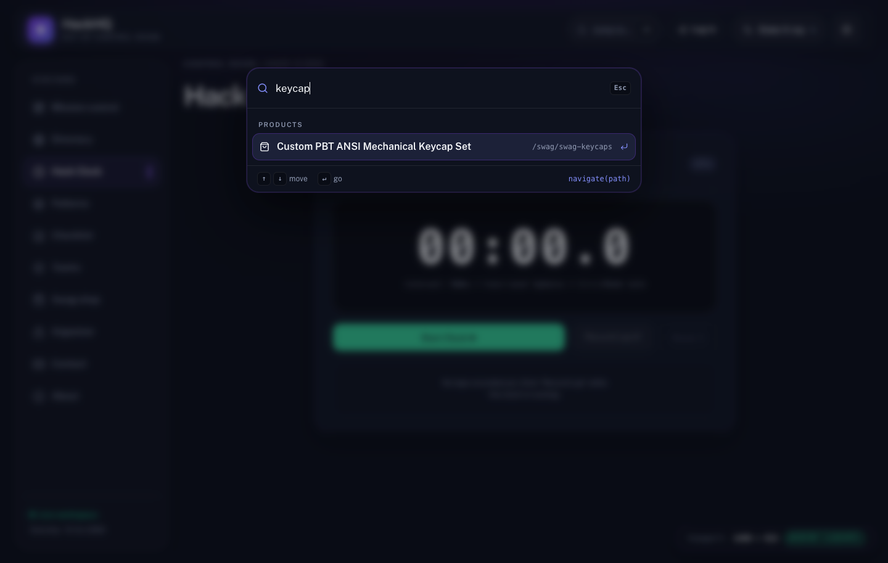
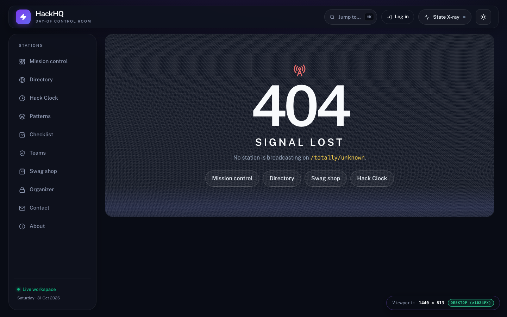
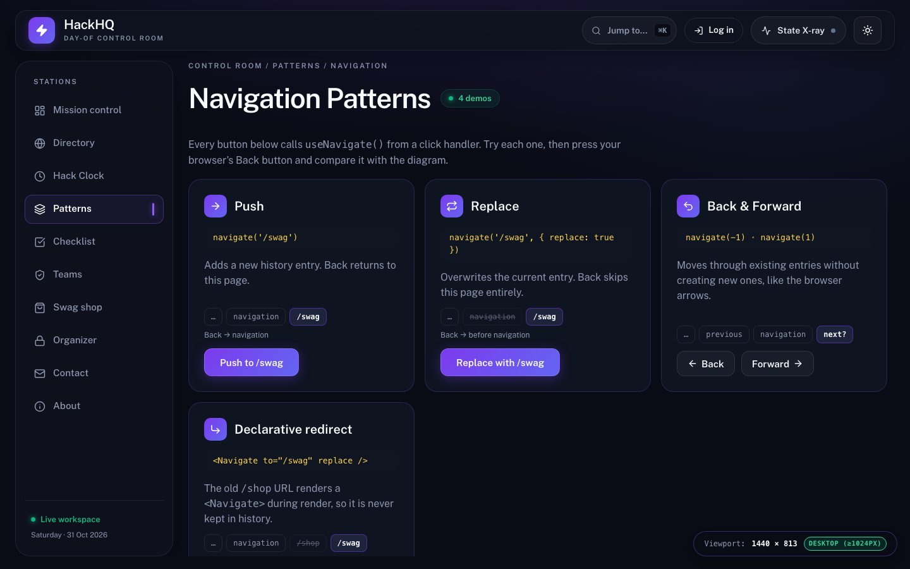
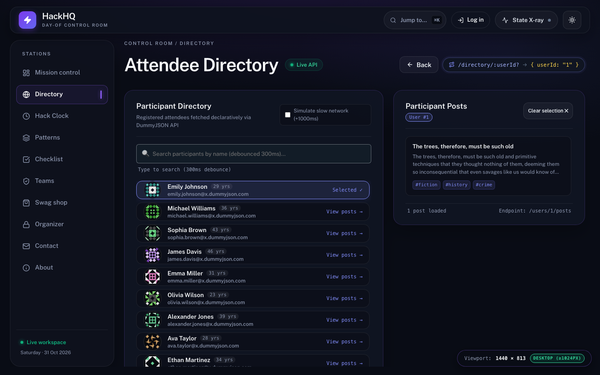
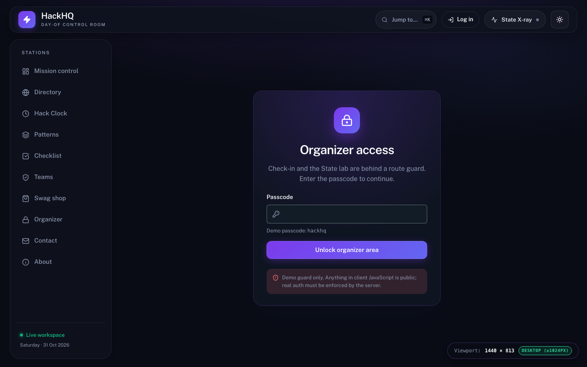

# HackHQ Router: React Router & Navigation

**Day 7 Project:** Linkific Month 1 Training  
**Author:** Ronit Ahuja  
**Stack:** React 19.3, React Router 7.18 (declarative mode), Vite 8, Vitest 4, native CSS tokens  
**Scope Guardrails:** `useState`, `useEffect`, `useId` and the Day 6 custom hooks, plus only the router APIs named in the Day 7 task. No Context, no data-router APIs, no extra libraries, zero `eslint-disable` comments.

**Docs:** [PRD](../Day7_PRD.md) · [Tech stack & architecture](../Day7_TECH_STACK_AND_ARCHITECTURE.md) · [Design spec](../Day7_DESIGN_SPEC.md) · [Verified facts](docs/FACTS.md)



---

## 1. Overview

HackHQ is the day-of control room for a 24-hour hackathon. On Day 5 and Day 6 it was a single screen whose "stations" were switched by a `useState('directory')` value and hidden panels. The URL never changed, so refresh, bookmarks, sharing a link and the Back button all failed.

Day 7 replaces that hand-rolled tab state with React Router. Every station has a real URL, and the app gains:

- product detail pages from a dynamic segment
- a directory driven by a URL param
- programmatic navigation on form submit, Back buttons and a keyboard palette
- redirects, a 404 page, and a guarded organizer area

### Day 6 → Day 7

| Concern                    | Day 6 (`hackhq-live`)                            | Day 7 (`hackhq-router`)                          |
| -------------------------- | ------------------------------------------------ | ------------------------------------------------ |
| Which screen is shown      | `activeStation` state + `hidden` panels          | URL matched by `<Routes>`                        |
| Mounted stations           | All 8, always (each toast re-rendered every one) | Only the matched page                            |
| Selected participant       | `selectedUserId` state                           | `/directory/:userId?` param                      |
| Refresh / bookmark / share | Always lands on Directory                        | Lands on the exact page                          |
| Back button                | Leaves the app                                   | Moves through visited pages                      |
| Sidebar                    | `<button role="tab">`                            | `<NavLink>` with automatic `aria-current="page"` |

---

## 2. Route Map

```jsx
<BrowserRouter useTransitions={false}>
  {' '}
  // main.jsx
  <Routes>
    {' '}
    // App.jsx
    <Route element={<AppLayout />}>
      {' '}
      // layout route: header + sidebar + <Outlet />
      <Route index element={<Home />} />
      <Route path="about" element={<About />} />
      <Route path="directory/:userId?" element={<DirectoryPage />} />
      <Route path="clock" element={<ClockPage />} />
      <Route path="patterns" element={<PatternsPage />} />
      <Route path="patterns/navigation" element={<NavPatterns />} />
      <Route path="checklist" element={<ChecklistStation />} />
      <Route path="teams" element={<TeamsStation />} />
      <Route path="swag">
        <Route index element={<SwagStation />} />
        <Route path=":productId" element={<ProductDetail />} />
      </Route>
      <Route path="login" element={<Login />} />
      <Route element={<ProtectedRoute isAllowed={isOrganizer} />}>
        {' '}
        // pathless guard
        <Route path="organizer">
          <Route index element={<OrganizerHome />} />
          <Route path="checkin" element={<CheckInStation />} />
          <Route path="lab" element={<StateLabStation />} />
        </Route>
      </Route>
      <Route path="contact" element={<Contact />} />
      <Route path="contact/sent" element={<ContactSent />} />
      <Route path="shop" element={<Navigate to="/swag" replace />} />
      <Route path="checkin" element={<Navigate to="/organizer/checkin" replace />} />
      <Route path="lab" element={<Navigate to="/organizer/lab" replace />} />
      <Route path="*" element={<NotFound />} />
    </Route>
  </Routes>
</BrowserRouter>
```

| URL                                                  | Page                      | Routing concept                               |
| ---------------------------------------------------- | ------------------------- | --------------------------------------------- |
| `/`                                                  | Mission control           | Index route, `<Link>` cards                   |
| `/about`                                             | About                     | Static route, live `<Link>` vs `<a>` demo     |
| `/directory`, `/directory/:userId`                   | Attendee directory        | Optional param, `useParams`, fetch by param   |
| `/swag`                                              | Swag shop (products list) | Nested index route                            |
| `/swag/:productId`                                   | Product detail            | Dynamic segment, data-miss state, Back button |
| `/clock`, `/patterns`, `/checklist`, `/teams`        | Day 5/6 stations          | Static routes                                 |
| `/patterns/navigation`                               | Navigation patterns       | Push, replace, back/forward, redirect         |
| `/contact` → `/contact/sent`                         | Contact form              | `navigate()` on submit with `replace`         |
| `/login`                                             | Organizer login           | Redirect target, `navigate()` after login     |
| `/organizer`, `/organizer/checkin`, `/organizer/lab` | Organizer area            | Protected layout route                        |
| `/shop`, `/checkin`, `/lab`                          | Legacy URLs               | `<Navigate replace>` redirects                |
| anything else                                        | Signal lost               | Catch-all `path="*"` and the `*` splat param  |

That is 20 route patterns in total (16 pages, 3 redirects and 1 catch-all), well above the 5 required.

---

## 3. Routing Concepts

### Client-side routing

The server sends one `index.html`. After that, the router reads `window.location`, picks the matching `<Route>`, and renders its element. Navigating calls `history.pushState`, which changes the URL without asking the server for a new document, and React re-renders. Nothing reloads, so in-memory state survives.

### `BrowserRouter` vs `HashRouter`

|                    | `BrowserRouter` (used here)                                                          | `HashRouter`                                                    |
| ------------------ | ------------------------------------------------------------------------------------ | --------------------------------------------------------------- |
| URL                | `/swag/swag-tee`                                                                     | `/#/swag/swag-tee`                                              |
| How                | HTML5 History API                                                                    | The part after `#`, which the browser never sends to the server |
| Server requirement | Must return `index.html` for **every** path, or a refresh on a deep link returns 404 | None; works on any static file host                             |
| Trade-off          | Clean, shareable, SEO-friendly URLs                                                  | Works anywhere, but uglier URLs and poor SEO                    |

Vite's dev server and `vite preview` already fall back to `index.html`, so deep links work locally. For a static host you need a rewrite rule (Netlify `/* /index.html 200`, a Vercel rewrite to `/index.html`), or switch to `HashRouter`.

### The building blocks

| Piece             | Role in this app                                                                                                                                   |
| ----------------- | -------------------------------------------------------------------------------------------------------------------------------------------------- |
| `<BrowserRouter>` | Wraps `<App />` once in `main.jsx`. Every `Link`, `Route` and router hook needs it as an ancestor.                                                 |
| `<Routes>`        | Looks at all child routes and renders the **single best match**.                                                                                   |
| `<Route>`         | Maps a `path` to an `element`. Child routes nest their paths under the parent's.                                                                   |
| `<Link>`          | Navigates without a reload. Used for every internal link.                                                                                          |
| `<NavLink>`       | A `Link` that knows whether it is active. The sidebar uses `className={({ isActive }) => …}`, and `end` on `/` so Home is not "active" everywhere. |
| `<Outlet />`      | Where a parent route renders its matched child (layout and guard routes).                                                                          |
| `<Navigate>`      | Redirects **during render**: legacy URLs, the guard, "already logged in".                                                                          |
| `useParams()`     | Reads dynamic segments: `productId`, `userId`, and `*` on the 404 page.                                                                            |
| `useNavigate()`   | Navigates **from events**: submit, click, keyboard.                                                                                                |

### `<Link>` vs `<a>`

The About page shows both side by side. `<a href="/">` makes the browser fetch a new document, so the whole app reboots and only `localStorage` (theme, laps, cart) survives. `<Link to="/">` calls `pushState`, so State X-ray, toasts and other in-memory state survive. Open DevTools → Network to see the extra document request.

### Dynamic and optional parameters

- **`/swag/:productId`**: `ProductDetail` reads `useParams().productId` and looks the product up during render. An unknown id still _matches_ the route, so the page shows a "Product not found" state. That is a data miss, not a 404.
- **`/directory/:userId?`**: the `?` makes the segment optional, so `/directory` and `/directory/3` match the **same** route. `Directory` stays mounted (the search text survives) while the URL decides who is selected.
- **Params are always strings.** `/directory/3` gives `"3"`, not `3`. `parseUserId` validates the string and converts it to a positive integer, and `/directory/abc` shows an "Unknown participant" panel. The live route badge prints params with their quotes to make this visible.
- **Fetching by param:** the parsed `userId` goes into the Day 6 `useFetch(buildUserPostsUrl(userId))`. Changing the URL changes the dependency, the previous request is aborted in cleanup, and the new one starts. Rapid clicks never show the wrong user's posts.

### Programmatic navigation

| Call                                           | Where                       | What Back does afterwards         |
| ---------------------------------------------- | --------------------------- | --------------------------------- |
| `navigate('/swag')` (push)                     | Navigation patterns page    | Returns to the page you came from |
| `navigate('/contact/sent', { replace: true })` | Contact form submit         | Skips the already-submitted form  |
| `navigate('/organizer', { replace: true })`    | Login submit                | Skips the login form              |
| `navigate(-1)` / `navigate(1)`                 | `BackButton`, patterns page | Same as the browser arrows        |
| `navigate(path)`                               | ⌘K command palette          | Push                              |

**Rule used everywhere:** `navigate()` only inside event handlers. A redirect decided during render uses `<Navigate>`, because calling `navigate()` while rendering is a side effect in render.

`BackButton` handles one edge case. If the page was opened directly from a shared link, `history.state.idx` is `0` and `navigate(-1)` would leave the app. In that case it falls back to the list page with `replace`.

### Nested, index and layout routes

- **Layout route:** `AppLayout` has an `element` but no `path`. The header and sidebar stay mounted while `<Outlet />` swaps pages.
- **Index route:** what a parent shows at its own URL: `/` (Home), `/swag` (products list), `/organizer` (organizer home).
- **Nested route:** `:productId` under `swag` resolves to `/swag/:productId`. The "Swag shop" `NavLink` stays active on every product page because it matches by prefix.

### 404

`path="*"` is the last child of the layout route, so unknown URLs keep the header and sidebar. `NotFound` reads the splat param (`useParams()['*']`) to say exactly which path had no station.

### Protected routes

```jsx
export default function ProtectedRoute({ isAllowed, redirectTo = '/login' }) {
  return isAllowed ? <Outlet /> : <Navigate to={redirectTo} replace />;
}
```

- **Conditional rendering:** the guard either renders the matched child or a redirect.
- **One guard, many pages:** the guard is a pathless layout route, so every `/organizer/*` child inherits it.
- **`replace` on redirect:** without it, Back from `/login` would return to the guarded URL, redirect again, and trap the user.
- **Auth check:** `isOrganizer` lives in `App` and is persisted with `useLocalStorage`. The passcode is `hackhq`.
- **Honest limitation:** this is a UX guard, not security. Everything in client JavaScript is readable. Real protection must happen on the server, for whatever data those pages would load.

---

## 4. Wow-Factor Features

| #   | Feature                  | How it works                                                                                                                                                                                                          |
| --- | ------------------------ | --------------------------------------------------------------------------------------------------------------------------------------------------------------------------------------------------------------------- |
| W1  | Page entrance animations | `.hackhq-main > *` animates on mount. Route elements remount on every navigation, so the animation replays; product pages use `key={product.id}` to replay between products. Disabled under `prefers-reduced-motion`. |
| W2  | "Signal lost" 404        | CSS static, scanlines and a glitching `404`, plus suggested links.                                                                                                                                                    |
| W3  | Live route badge         | `RouteBadge` calls `useParams()` and prints `pattern → { param: "value" }`.                                                                                                                                           |
| W4  | Hero product page        | Category-coloured CSS visual, specs, previous/next links that wrap, a sticky add-to-cart bar.                                                                                                                         |
| W5  | ⌘K command palette       | A global `keydown` listener in `useEffect` (removed in cleanup); filters every page and product; ↑/↓/Enter/Esc; `navigate(path)`. Mounted only while open, so its state resets for free.                              |

|                                                                         |                                                              |
| ----------------------------------------------------------------------- | ------------------------------------------------------------ |
|                |   |
|                    |  |
|  |             |

---

## 5. Things We Learned the Hard Way

1. **Routes unmount pages.** Day 5 kept every station mounted with `hidden`, so state survived switching. With routing, leaving `/organizer/checkin` destroys its `useState`, and the count resets. We lifted only the **cart** into `App` (persisted with `useLocalStorage`) because the list and detail pages share it. The other stations resetting is intended, documented behaviour.
2. **React Router 7 navigates inside `startTransition`.** On logout, the urgent `setIsOrganizer(false)` rendered first while the URL was still `/organizer`, so the guard bounced the user to `/login` instead of `/`. `<BrowserRouter useTransitions={false}>` makes location updates synchronous, so the state change and `navigate('/')` render together. We found this by driving a real browser, not by reading code.
3. **Peer dependency drift from Day 6.** Day 6 shipped Vite 8 with `@vitejs/plugin-react` 4 (which only supports up to Vite 7). It worked only because `node_modules` was already installed; a fresh `npm install` refused. The fix was upgrading the plugin to v6, not `--legacy-peer-deps`.
4. **CSS specificity bugs inherited from Day 5/6.** `input[type='text']` (0,1,1) beat `.live-search-input` (0,1,0), so the search icon covered the placeholder. The fixed viewport badge also covered the mobile bottom nav. Both are fixed here, with comments explaining why.

---

## 6. Strict Scope & Verification

```bash
# forbidden React hooks: expect 0
grep -rnE "useReducer|useContext|createContext|useRef|useMemo|useCallback|useLayoutEffect" src | wc -l
# forbidden router APIs (data mode, location hooks): expect 0
grep -rnE "useLocation|useSearchParams|useOutletContext|useMatch|createBrowserRouter|RouterProvider|useLoaderData" src | wc -l
# forbidden libraries: expect 0
grep -rnEi "axios|tanstack|swr|redux|zustand" src package.json | wc -l
# no lint suppressions: expect 0
grep -rn "eslint-disable" src test | wc -l

npm run lint && npm test && npm run build && npm run format:check
```

All four greps return `0`; lint is clean, the tests pass (76), and Prettier is happy. See [docs/FACTS.md](docs/FACTS.md) for the measured numbers and the browser-driven interaction checks.

**Known limitations (out of scope by design):**

- After login the app always goes to `/organizer`. Returning to the originally requested page needs `useLocation` + `location.state`, which is not in the Day 7 API list.
- A coupon applied on `/swag` is cleared when you open a product page; only the cart was lifted.
- Not deployed today; see the rewrite note under BrowserRouter vs HashRouter.

---

## 7. Deliverables Checklist

| Deliverable                      | Where                                                                                                                                                                                                                                        |
| -------------------------------- | -------------------------------------------------------------------------------------------------------------------------------------------------------------------------------------------------------------------------------------------- |
| Multi-page React application     | [src/App.jsx](src/App.jsx) route tree                                                                                                                                                                                                        |
| At least 5 routes                | 20 route patterns                                                                                                                                                                                                                            |
| Navigation header with `NavLink` | [src/components/Navigation.jsx](src/components/Navigation.jsx)                                                                                                                                                                               |
| Dynamic route with `useParams`   | [src/pages/swag/ProductDetail.jsx](src/pages/swag/ProductDetail.jsx), [src/pages/stations/DirectoryPage.jsx](src/pages/stations/DirectoryPage.jsx)                                                                                           |
| 404 error page                   | [src/pages/NotFound.jsx](src/pages/NotFound.jsx)                                                                                                                                                                                             |
| Programmatic navigation examples | [Contact.jsx](src/pages/Contact.jsx), [BackButton.jsx](src/components/layout/BackButton.jsx), [NavPatterns.jsx](src/pages/NavPatterns.jsx), [CommandPalette.jsx](src/components/layout/CommandPalette.jsx), [Login.jsx](src/pages/Login.jsx) |
| Protected route example (bonus)  | [src/components/auth/ProtectedRoute.jsx](src/components/auth/ProtectedRoute.jsx)                                                                                                                                                             |
| README with routing concepts     | This file                                                                                                                                                                                                                                    |

---

## 8. File Map (Day 7 additions)

```
src/
├── main.jsx                        # <BrowserRouter useTransitions={false}>
├── App.jsx                         # shared state + <Routes> tree
├── components/
│   ├── Navigation.jsx              # NavLink sidebar
│   ├── Header.jsx                  # logo Link, ⌘K trigger, login/logout pill
│   ├── auth/ProtectedRoute.jsx     # guard layout route
│   └── layout/
│       ├── AppLayout.jsx           # layout route + ⌘K listener
│       ├── PageHeader.jsx          # breadcrumb/title/pill
│       ├── RouteBadge.jsx          # W3 live pattern + params
│       ├── BackButton.jsx          # navigate(-1) with fallback
│       └── CommandPalette.jsx      # W5
├── pages/
│   ├── Home.jsx · About.jsx · NotFound.jsx · Contact.jsx · ContactSent.jsx
│   ├── NavPatterns.jsx · Login.jsx
│   ├── organizer/OrganizerHome.jsx
│   ├── stations/DirectoryPage.jsx · ClockPage.jsx · PatternsPage.jsx
│   └── swag/ProductDetail.jsx
├── lib/
│   ├── routes.js                   # productPath, userPath, findProduct, parseUserId…
│   ├── commands.js                 # palette data + filtering
│   ├── contact.js                  # contact form validation
│   └── auth.js                     # demo passcode check
└── data/stations.js                # every nav entry with an absolute path
test/  routes · commands · contact · auth (+ Day 5 cart, checklist, counter, validation)
```

---

## 9. Running Locally

```bash
cd Day-07/hackhq-router
npm install
npm run dev            # http://localhost:5173
npm test               # 76 Vitest tests
npm run lint
npm run build && npm run preview
```

Things to try: open `http://localhost:5173/swag/swag-tee` in a new tab; press ⌘K (Ctrl+K) and type "hoodie"; submit the Contact form and then press Back; open `/organizer/lab` while logged out.
