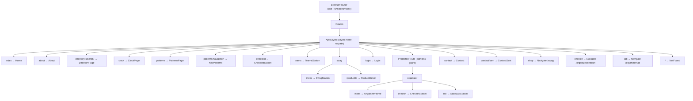
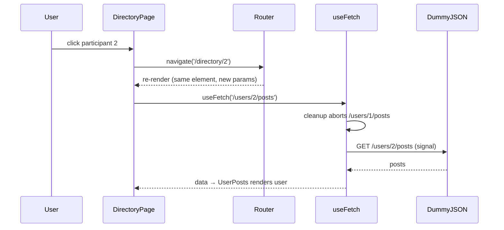
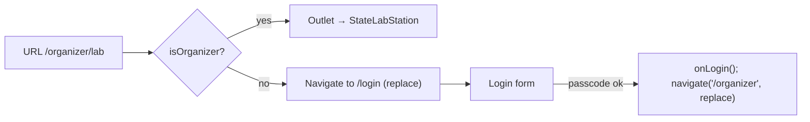

# Tech Stack & Architecture: HackHQ Router (Day 7)

| Field          | Value                                                            |
| -------------- | ---------------------------------------------------------------- |
| Owner          | Ronit Ahuja                                                      |
| Date           | Saturday, 31 October 2026                                        |
| Status         | Reflects the code merged on `main` after PR #34                  |
| Companion docs | `Day7_PRD.md`, `Day7_DESIGN_SPEC.md`, `FACTS.md`, `../README.md` |

---

## 1. System Overview

HackHQ Router is a client-only single-page app. The server (Vite in development) returns one `index.html` for every path. From then on, React Router reads the URL and decides which page component to mount. The only network traffic after load is the DummyJSON API used by the directory.

```
Browser URL ──► BrowserRouter (main.jsx) ──► Routes (App.jsx) ──► one matched page
                     │                             │
                     │ History API                 └─ AppLayout (header, sidebar, palette, toasts)
                     │ pushState / replaceState         └─ <Outlet /> ◄── the page
                     ▼
              App state (theme, cart, isOrganizer, laps, xray, toasts) ──props──► pages
                     │
                     └─ useLocalStorage ──► localStorage (theme, laps, cart, organizer flag, tasks)

DirectoryPage ── useParams(userId) ──► useFetch(url) ──► https://dummyjson.com/users/:id/posts
```

### Day 6 → Day 7 structural change

| Concern              | Day 6                             | Day 7                      |
| -------------------- | --------------------------------- | -------------------------- |
| Screen selection     | `activeStation` state in `App`    | URL, matched by `<Routes>` |
| Inactive stations    | Mounted, `hidden`                 | Unmounted                  |
| Selected participant | `selectedUserId` state            | `:userId?` URL segment     |
| Shell                | Rendered inline by `App`          | `AppLayout` layout route   |
| Navigation UI        | `<button role="tab">` + `onClick` | `<NavLink>`                |

## 2. Technology Stack

| Layer          | Technology (installed version)                                             | Why                                                                                                                                              |
| -------------- | -------------------------------------------------------------------------- | ------------------------------------------------------------------------------------------------------------------------------------------------ |
| UI runtime     | React 19.3.1, react-dom                                                    | Linkific standard; StrictMode on                                                                                                                 |
| Routing        | **react-router-dom 7.18.5**, declarative mode                              | The Day 7 subject. Declarative mode (`<BrowserRouter>` + `<Routes>`) matches the task's API list and the v6-style tutorials                      |
| Build          | Vite 8.3.5 + @vitejs/plugin-react **6.1.2**                                | Fast HMR; dev server already does SPA history fallback. Plugin upgraded from 4 → 6 because 4.x only supports Vite ≤ 7 (inherited Day 6 conflict) |
| Data fetching  | Day 6 `useFetch` (fetch + `AbortController`)                               | No new library; aborts stale param-driven requests                                                                                               |
| Persistence    | Day 6 `useLocalStorage`                                                    | Same `[value, setValue]` tuple as `useState`                                                                                                     |
| Styling        | Native CSS tokens in `src/index.css` (5,430 lines incl. Day 5/6)           | No runtime cost; all Day 7 motion is CSS                                                                                                         |
| Icons          | lucide-react 0.468                                                         | Already in the project                                                                                                                           |
| Unit tests     | Vitest 4.1                                                                 | Pure functions in `src/lib/`                                                                                                                     |
| Browser checks | Headless Chrome via the DevTools Protocol (scratch scripts, not committed) | Verifies real navigation, history and guards; see `FACTS.md` §3                                                                                  |
| Quality        | ESLint 9 (react, react-hooks, react-refresh), Prettier 3                   | 0 errors, 0 `eslint-disable`                                                                                                                     |

**New runtime dependency on Day 7:** `react-router-dom` only.

## 3. Strict Scope & Guardrail Compliance

| Category          | Allowed and used                                                              | Forbidden (grep-audited to 0)                                                                      |
| ----------------- | ----------------------------------------------------------------------------- | -------------------------------------------------------------------------------------------------- |
| React hooks       | `useState`, `useEffect`, `useId`                                              | `useReducer`, `useContext`, `createContext`, `useRef`, `useMemo`, `useCallback`, `useLayoutEffect` |
| Custom hooks      | `useFetch`, `useDebounce`, `useStopwatch`, `useWindowSize`, `useLocalStorage` | —                                                                                                  |
| Router components | `BrowserRouter`, `Routes`, `Route`, `Link`, `NavLink`, `Navigate`, `Outlet`   | `createBrowserRouter`, `RouterProvider`, `<Form>`, `<Await>`                                       |
| Router hooks      | `useParams`, `useNavigate`                                                    | `useLocation`, `useSearchParams`, `useOutletContext`, `useMatch`, `useLoaderData`, `useNavigation` |
| Libraries         | `react-router-dom`                                                            | axios, TanStack, SWR, Redux, Zustand, auth libraries                                               |

**Consequences of the scope, by design:**

- Shared state reaches pages as **props** passed in the route `element`, not through Context or `useOutletContext`.
- The guard cannot remember the originally requested URL (that needs `useLocation`), so login always continues to `/organizer`.
- The palette and `BackButton` use DOM APIs (`document.getElementById(...).scrollIntoView`, `window.history.state.idx`) inside event handlers instead of refs.

## 4. Routing Architecture

### 4.1 Route tree



20 URL patterns: 16 pages, 3 redirects, 1 catch-all. `<Routes>` ranks every candidate and picks the most specific: static segments beat dynamic ones, `:productId` can only match under `swag/`, and `*` wins only when nothing else matches.

### 4.2 Route types used

| Type              | Example                            | Mechanism                                                                     |
| ----------------- | ---------------------------------- | ----------------------------------------------------------------------------- |
| Layout route      | `AppLayout`                        | `element` without `path`; renders `<Outlet />`                                |
| Pathless guard    | `ProtectedRoute`                   | `element` without `path`; renders `<Outlet />` or `<Navigate>`                |
| Index route       | `/`, `/swag`, `/organizer`         | `<Route index>`                                                               |
| Nested route      | `swag/:productId`, `organizer/lab` | Child paths join the parent path                                              |
| Dynamic segment   | `:productId`                       | `useParams().productId`                                                       |
| Optional segment  | `:userId?`                         | `/directory` and `/directory/3` share one route, so the element stays mounted |
| Splat / catch-all | `*`                                | `useParams()['*']` holds the unmatched path                                   |
| Redirect          | `/shop`                            | `<Navigate to="/swag" replace />` during render                               |

### 4.3 Navigation API usage

| API                  | Used in                                                                                                        | Rule                                                      |
| -------------------- | -------------------------------------------------------------------------------------------------------------- | --------------------------------------------------------- |
| `<Link>`             | Home cards, product names, pager, 404 suggestions, About demo                                                  | Every internal link (except the one labelled `<a>` demo)  |
| `<NavLink>`          | `Navigation.jsx`                                                                                               | `end` on `/`; `className` and children receive `isActive` |
| `useNavigate()`      | Contact, Login, OrganizerHome, Header logout, DirectoryPage row click, BackButton, NavPatterns, CommandPalette | Only inside event handlers                                |
| `<Navigate replace>` | Redirect routes, guard, logged-in `/login`                                                                     | Only for decisions made during render                     |

### 4.4 Path construction

All internal paths are **absolute** and built by `src/lib/routes.js` (`productPath`, `userPath`) or declared in `src/data/stations.js`. A link means the same thing no matter which nested route renders it, which avoids `/swag/swag/...` relative-path bugs.

## 5. State Architecture

### 5.1 What lives where

| State                                     | Owner                  | Persisted            | Consumers                                            | Why there                                      |
| ----------------------------------------- | ---------------------- | -------------------- | ---------------------------------------------------- | ---------------------------------------------- |
| `theme`                                   | `App`                  | ✔ `hackhq_theme`     | `AppLayout` → `Header`                               | Global                                         |
| `xrayOn`, `toasts`                        | `App`                  | —                    | Layout + stations via props                          | Global UI                                      |
| `laps`                                    | `App`                  | ✔ `hackhq_laps`      | `ClockPage`                                          | Day 6 behaviour                                |
| `cart`                                    | `App`                  | ✔ `hackhq_cart`      | `SwagStation` **and** `ProductDetail`                | Shared by two routes, and routes unmount       |
| `isOrganizer`                             | `App`                  | ✔ `hackhq_organizer` | `ProtectedRoute`, `Login`, `Header`, `OrganizerHome` | Guard input                                    |
| Selected participant                      | **URL** (`:userId?`)   | via URL              | `DirectoryPage`                                      | Shareable; Back works                          |
| Selected product                          | **URL** (`:productId`) | via URL              | `ProductDetail`                                      | Shareable                                      |
| `paletteOpen`                             | `AppLayout`            | —                    | Header button, ⌘K listener                           | Layout-level UI                                |
| Palette `query`, `activeIndex`            | `CommandPalette`       | —                    | itself                                               | Mounted only while open, so it resets for free |
| Contact `form`, `touched`, `submitted`    | `Contact`              | —                    | itself                                               | Errors derived via `validateContact`           |
| Station internals (count, coupon, teams…) | Each station           | Checklist tasks only | itself                                               | Reset on navigation (documented)               |

### 5.2 The unmount rule

A route element exists only while its route matches. Leaving `/organizer/checkin` destroys `CheckInStation`'s `useState`. The rule applied: **lift state only when two routes share it or it must survive navigation.** The cart met that bar; the check-in count did not.

### 5.3 Derived, not stored

| Value                          | Derived from                                     |
| ------------------------------ | ------------------------------------------------ |
| `userId` (number or null)      | `parseUserId(useParams().userId)`                |
| `isInvalidId`                  | raw param present but `userId === null`          |
| `product`, `previous`, `next`  | `findProduct` / `getAdjacentProducts(productId)` |
| `quantityInCart`, `totalItems` | `cart`                                           |
| Contact `errors`               | `validateContact(form)`                          |
| Palette `results`, `safeIndex` | `filterCommands(COMMANDS, query)`, `activeIndex` |

## 6. Key Flows

### 6.1 Param change drives a fetch



### 6.2 Guard decision



### 6.3 Logout (the transition bug)

`BrowserRouter` normally applies location updates inside `React.startTransition`. On logout, `setIsOrganizer(false)` (urgent) rendered **before** the transition carrying `navigate('/')`, so `ProtectedRoute` saw "logged out on `/organizer`" and redirected to `/login`.

**Fix:** `<BrowserRouter useTransitions={false}>` (in `main.jsx`, with a comment). The router's `setState` then runs synchronously in the same event, both updates batch into one render, and the user lands on `/`. Verified by the header and page logout checks.

## 7. Module Map

| Module                                 | Kind           | Responsibility                                                     |
| -------------------------------------- | -------------- | ------------------------------------------------------------------ |
| `src/main.jsx`                         | entry          | StrictMode + `BrowserRouter`                                       |
| `src/App.jsx`                          | root           | Shared state, route tree                                           |
| `components/layout/AppLayout.jsx`      | layout route   | Shell, `<Outlet />`, ⌘K `keydown` listener (`useEffect` + cleanup) |
| `components/Navigation.jsx`            | UI             | `NavLink` list from `STATIONS`                                     |
| `components/Header.jsx`                | UI             | Logo link, palette trigger, login/logout pill, X-ray, theme        |
| `components/auth/ProtectedRoute.jsx`   | guard route    | `Outlet` or `Navigate`                                             |
| `components/layout/CommandPalette.jsx` | UI             | Combobox/listbox, keyboard handling, `navigate(path)`              |
| `components/layout/BackButton.jsx`     | UI             | `navigate(-1)` with `history.state.idx` fallback                   |
| `components/layout/RouteBadge.jsx`     | UI             | Pattern + live params                                              |
| `components/layout/PageHeader.jsx`     | UI             | Breadcrumb, title, pill, actions slot                              |
| `pages/*`                              | route elements | One file per page                                                  |
| `lib/routes.js`                        | pure           | Path builders, product lookup, adjacency, `parseUserId`            |
| `lib/commands.js`                      | pure           | Palette command list + ranked filtering                            |
| `lib/contact.js`                       | pure           | Contact topics + validation                                        |
| `lib/auth.js`                          | pure           | Demo passcode check                                                |
| `data/stations.js`                     | data           | Every nav entry with an absolute `path`                            |

Largest Day 7 files: `ProductDetail.jsx` 166 lines, `App.jsx` 147, `Contact.jsx` 135, `CommandPalette.jsx` 132.

## 8. Architecture Decisions (ADR summary)

| #   | Decision                                              | Alternatives considered                                            | Reason                                                                                          |
| --- | ----------------------------------------------------- | ------------------------------------------------------------------ | ----------------------------------------------------------------------------------------------- |
| 1   | Declarative mode (`BrowserRouter` + `Routes`)         | Data router (`createBrowserRouter`, loaders)                       | Matches the Day 7 task's API list; data mode is a later topic                                   |
| 2   | `BrowserRouter`                                       | `HashRouter`                                                       | Clean URLs; Vite handles fallback locally. HashRouter documented as the static-host alternative |
| 3   | URL as source of truth for selection                  | `useState` (Day 6)                                                 | Refresh, share and Back work; no duplicate state                                                |
| 4   | Props for shared state                                | Context, `useOutletContext`                                        | Both forbidden by scope; the tree is shallow                                                    |
| 5   | Lift only the cart                                    | Lift every station                                                 | Minimal change; other resets are a teaching point                                               |
| 6   | Absolute path helpers                                 | Relative `to` values                                               | No nested-path ambiguity                                                                        |
| 7   | `useTransitions={false}`                              | Reorder calls, `setTimeout` hacks, `startTransition` around logout | One documented prop; keeps the guard pure                                                       |
| 8   | Palette mounted only while open                       | Always mounted with reset logic                                    | Unmount = free reset; no effect to clear state                                                  |
| 9   | `BackButton` reads `history.state.idx` in the handler | `useLocation` (forbidden), always `navigate(-1)`                   | Never leaves the app on a fresh deep link                                                       |
| 10  | `@vitejs/plugin-react` 6                              | `--legacy-peer-deps`                                               | Fixes the conflict instead of hiding it                                                         |

## 9. Testing Strategy

| Layer           | Tool                                    | Coverage                                                                                                                                                                    |
| --------------- | --------------------------------------- | --------------------------------------------------------------------------------------------------------------------------------------------------------------------------- |
| Pure logic      | Vitest                                  | 76 tests / 8 files. Day 7: `routes` (6), `commands` (5), `contact` (5), `auth` (2)                                                                                          |
| Real navigation | Headless Chrome over CDP                | 53 checks / 5 suites: deep links, active links, Back/Forward, cart across routes, param fetch, push vs replace, redirects, guard, both logouts, palette, zero console noise |
| Visual          | Headless screenshots at 1440 and 500 px | `docs/screenshots/` (10)                                                                                                                                                    |
| Static          | ESLint, Prettier, grep scope audits     | All clean / 0                                                                                                                                                               |

Not covered: component tests with a DOM renderer (would need new dev dependencies), screen readers, Lighthouse, real devices.

## 10. Build & Deployment

| Command           | Result                                                      |
| ----------------- | ----------------------------------------------------------- |
| `npm run dev`     | http://localhost:5173, history fallback built in            |
| `npm run build`   | JS 395.83 kB (118.50 kB gzip), CSS 81.97 kB (15.34 kB gzip) |
| `npm run preview` | Serves `dist/` with fallback                                |

**Deploying `BrowserRouter`:** the host must rewrite every path to `/index.html` (Netlify `_redirects`: `/* /index.html 200`; Vercel: a rewrite to `/index.html`). Without it, refreshing `/swag/swag-tee` returns the host's 404. Not deployed today.

## 11. Known Limitations & Next Steps

| Limitation                             | Next step (later day)                  |
| -------------------------------------- | -------------------------------------- |
| Login always continues to `/organizer` | `useLocation` + `state.from`           |
| Coupon resets when leaving `/swag`     | Lift `appliedCoupon` next to `cart`    |
| No per-page `<title>`                  | P1 `useDocumentTitle` hook             |
| No static-host rewrite files           | P1 `_redirects` / `vercel.json`        |
| Client-only guard                      | Server-side auth when a backend exists |
