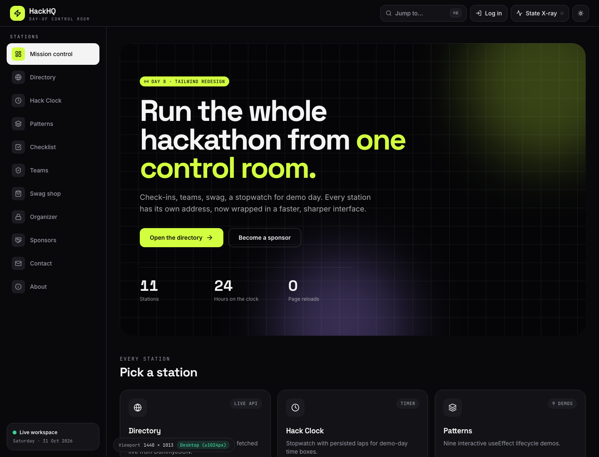
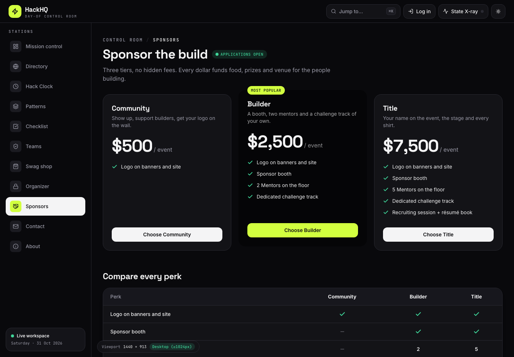
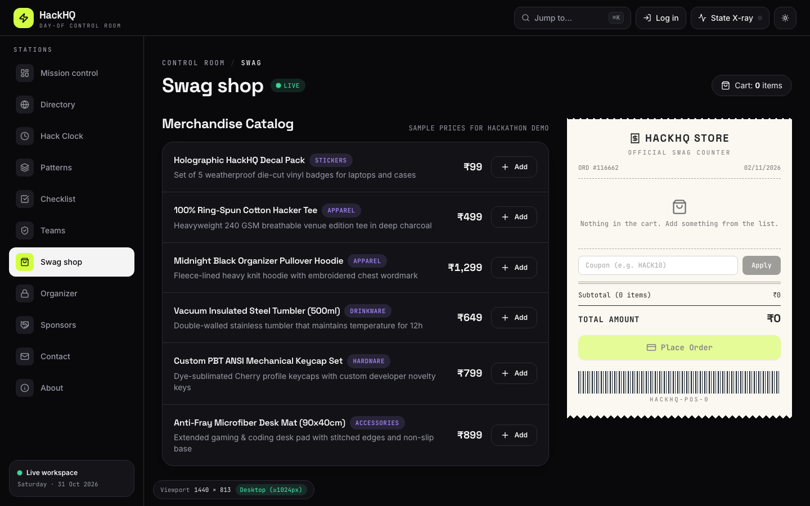
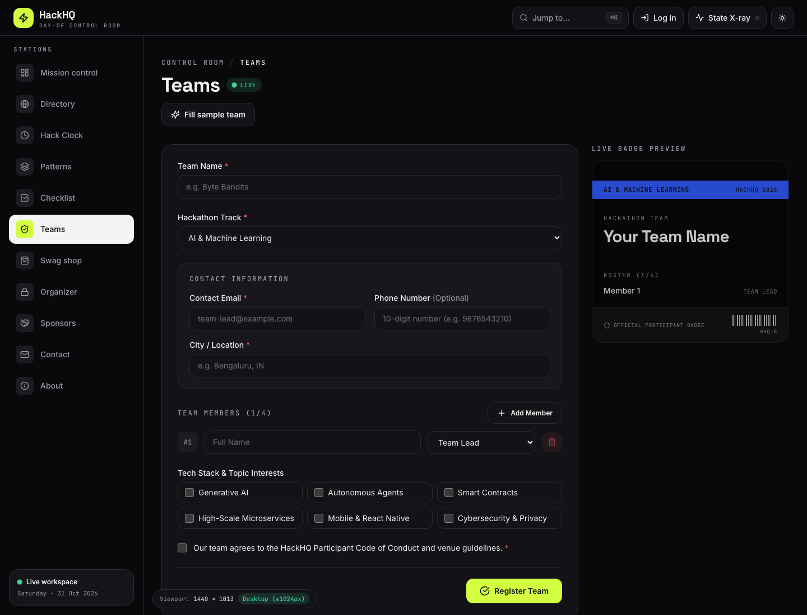
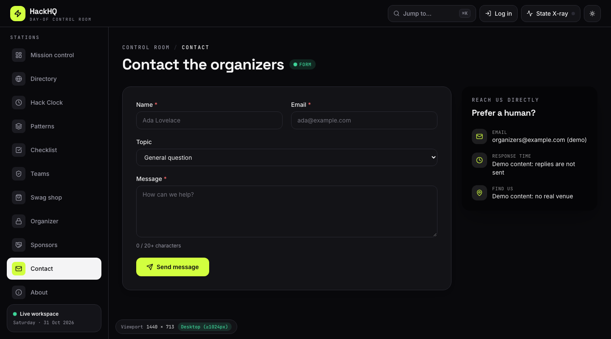
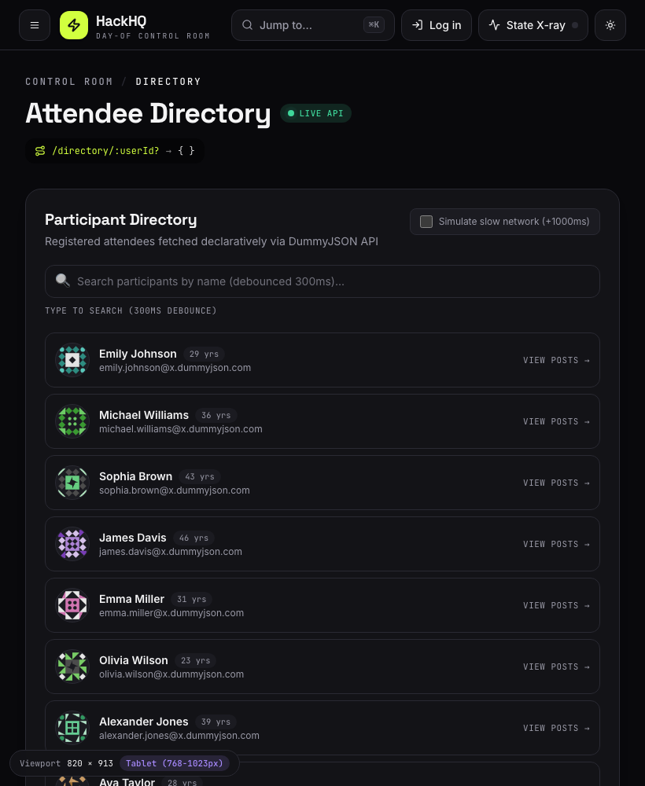

# HackHQ: Tailwind CSS Redesign

**Day 8 Project:** Linkific Month 1 Training
**Author:** Ronit Ahuja
**Stack:** React 19, React Router 7, Vite 8, **Tailwind CSS 4** (`@tailwindcss/vite`), Vitest 4
**Starting point:** the Day 7 app (`Day-07/hackhq-router`). Behaviour, routes and tests are unchanged. Only the interface was rebuilt.



---

## 1. What changed

The 5,400-line hand-written `index.css` was deleted. Every page and component is now styled with Tailwind utility classes, on top of a small design system.

| Before (Day 7)                              | After (Day 8)                                     |
| ------------------------------------------- | ------------------------------------------------- |
| One 5,430-line stylesheet, ~700 class names | ~230 lines of CSS: tokens, keyframes, base styles |
| Hand-rolled `.dark` overrides everywhere    | Semantic colour tokens that flip automatically    |
| Fixed-height, `overflow: hidden` app shell  | Sticky header + sidebar, normal page scrolling    |
| Sidebar hidden on small screens             | Off-canvas drawer below `lg`                      |
| No pricing, hero or footer                  | Hero, `/sponsors` pricing table, footer           |

## 2. Screens

|                                                                  |                                             |
| ---------------------------------------------------------------- | ------------------------------------------- |
|                     |        |
|                           |  |
|  |                                             |

## 3. Deliverables checklist

- [x] React app fully styled with Tailwind
- [x] 6+ responsive components: header/navbar, hero, station card grid, pricing table, contact form, footer, command palette, toasts, split-flap board
- [x] Tailwind configuration customised (`@theme` in `src/index.css`)
- [x] Mobile, tablet and desktop layouts
- [x] Dark mode toggle (bonus), persisted, no flash on load
- [x] README with Tailwind learnings (below)

## 4. Tailwind setup (v4)

Tailwind 4 needs no `tailwind.config.js` or PostCSS file. Configuration lives in CSS.

```js
// vite.config.js
import tailwindcss from '@tailwindcss/vite';
export default defineConfig({ plugins: [react(), tailwindcss()] });
```

```css
/* src/index.css */
@import 'tailwindcss';
@custom-variant dark (&:where(.dark, .dark *));
@theme {
  --font-display: 'Space Grotesk Variable', sans-serif; /* … */
}
```

The v3 steps from the task map to v4 like this:

| v3 step                               | v4 equivalent                                         |
| ------------------------------------- | ----------------------------------------------------- |
| `tailwind.config.js` `theme.extend`   | `@theme { … }` in CSS                                 |
| PostCSS + autoprefixer                | The Vite plugin handles it                            |
| `@tailwind base/components/utilities` | `@import 'tailwindcss'`                               |
| `content: [...]` / PurgeCSS           | Automatic source detection; unused classes never ship |

## 5. The design system

**Semantic tokens.** Colours are CSS variables (`--surface`, `--ink`, `--line`, `--brand` …) defined for light under `:root` and for dark under `.dark`. `@theme inline` exposes them as utilities, so `bg-surface text-ink border-line` is correct in both themes with **no `dark:` prefix**. Only genuinely theme-specific tweaks use `dark:`.

**Primitives** (`src/components/ui.jsx`): `Button` / `buttonClass`, `Card`, `Badge`, `PulseDot`, `Eyebrow`, `Kbd`, and form class strings. A design change is a one-file edit.

**Look:** near-black and warm-white surfaces, one volt-lime accent, violet for links and highlights, Space Grotesk headings, Inter body, JetBrains Mono for micro-labels.

## 6. Tailwind learnings

1. **Utility-first removes naming and dead CSS.** I never had to invent `.sidebar-footer-card`, and deleting a component deletes its styles with it.
2. **Mobile-first is the default.** `grid sm:grid-cols-2 xl:grid-cols-3` reads as "one column, then two, then three". Unprefixed classes are the mobile design.
3. **Utilities can fight each other.** `inline-flex` and `hidden` on one element have equal specificity, so the later rule in the stylesheet wins, not the later class. A header pill stayed visible on phones until I switched to `max-md:hidden`. Prefer variants over stacking display utilities.
4. **Tokens beat colour scales for theming.** Hard-coding `bg-zinc-900 dark:bg-white` in hundreds of places is brittle; naming roles once is not.
5. **Class strings are data.** `cx()` plus lookup objects (`BADGE_TONES`) keep conditional styling readable. Never build class names by concatenation (`bg-${tone}`), because Tailwind cannot see them.
6. **Arbitrary values are an escape hatch.** The thermal receipt's sawtooth edge and barcode are `[background-image:…]` gradients. Fine for one-offs; move to `@theme` if you use one twice.
7. **Set the theme before paint.** Toggling `.dark` from a React effect flashes the light theme. A tiny inline script in `index.html` sets the class first.
8. **`has-[:checked]` and `aria-[invalid=true]`** let DOM state drive styles, so error styling comes from the accessibility attribute instead of an extra class.

## 7. Running locally

```bash
cd Day-08/hackhq-tailwind
npm install
npm run dev        # http://localhost:5173
npm run build      # production build (unused CSS is never emitted)
npm test           # 76 unit tests, all pure logic
npm run lint
```

## 8. Verification

- `npm run build`: passes
- `npm run lint`: 0 errors (2 `react-refresh` warnings in `ui.jsx`, which exports helpers beside components)
- `npm test`: 76 / 76
- Pages checked in headless Chrome at 390 px, 820 px and 1440 px

The original product specs live with the earlier days: [Day 5](../../Day-05/docs/Day5_PRD.md) and [Day 7](../../Day-07/Day7_PRD.md).
