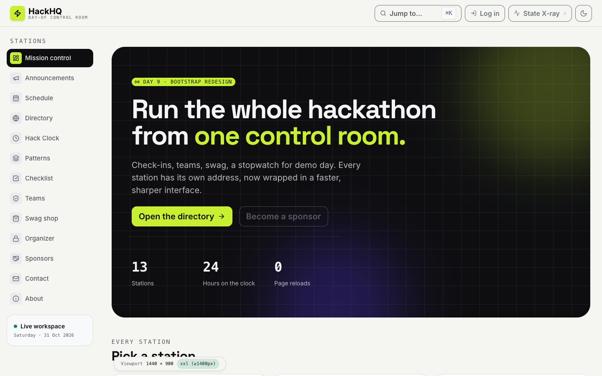
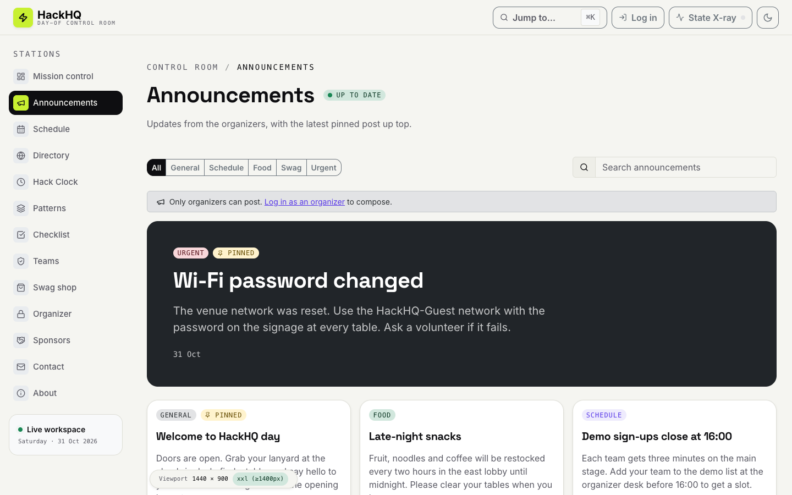
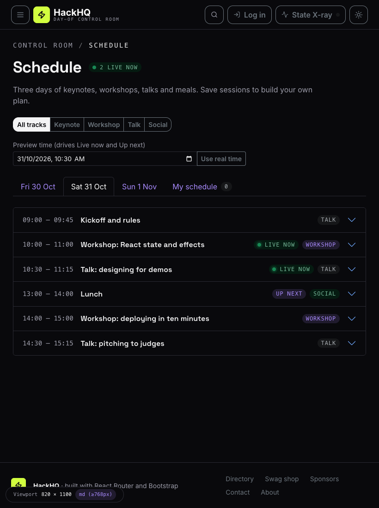
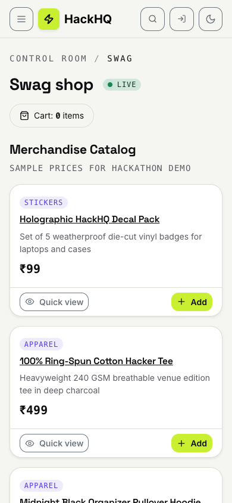
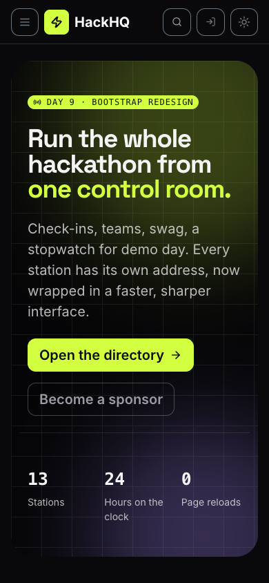

# HackHQ: Bootstrap 5 Redesign

**Day 9 Project:** Linkific Month 1 Training
**Author:** Ronit Ahuja
**Stack:** React 19, React Router 7, Vite 8, **Bootstrap 5.3** and **React Bootstrap 2**, Vitest 4
**PRD:** [Day9_PRD.md](../Day9_PRD.md)
**Comparison:** [BOOTSTRAP_VS_TAILWIND.md](../BOOTSTRAP_VS_TAILWIND.md), with the raw numbers in [BASELINE.md](../BASELINE.md)
**Starting point:** the Day 8 app (`Day-08/hackhq-tailwind`). Tailwind was removed and every page was restyled with Bootstrap. Two features were added: **Announcements** and **Event schedule**.



---

## 1. What changed

| Before (Day 8)                                   | After (Day 9)                                                   |
| ------------------------------------------------ | --------------------------------------------------------------- |
| Tailwind utility classes (498 distinct names)    | Bootstrap classes and React Bootstrap components (231 distinct) |
| `@theme` tokens flipping through a `.dark` class | Bootstrap colour modes through `data-bs-theme`                  |
| Hand-built drawer, toasts, command palette       | `Offcanvas`, `Toast`, `Modal` with `ListGroup`                  |
| No new behaviour                                 | **Announcements** feed and **Event schedule** (section 3)       |
| 76 tests                                         | 134 tests (30 for announcements, 28 for the schedule)           |

## 2. Screens

|                                                                 |                                                           |
| --------------------------------------------------------------- | --------------------------------------------------------- |
|  |  |
|             |   |

All 24 screenshots (4 pages, 3 widths, light and dark) are in [`docs/screenshots`](docs/screenshots).

## 3. The two new features

**Announcements** (`/announcements`): a featured card for the latest pinned post and a responsive card grid, with a category `ButtonGroup`, search and an unread count on the nav link. Organizers (the existing organizer flag) can publish, edit, pin and delete from a modal with a validated form. Attendees get a read-only view. Logic: [`src/lib/announcements.js`](src/lib/announcements.js).

**Event schedule** (`/schedule`): a `Tab` per day plus **My schedule**, session details in an `Accordion`, a track filter, save-to-my-schedule, a warning when two saved sessions overlap, and Live now and Up next badges. The event dates are in the past, so a **Preview time** input (`?at=2026-10-31T10:30`) drives the badges. Logic: [`src/lib/schedule.js`](src/lib/schedule.js).

Both keep their logic in pure `src/lib/` files with unit tests, and store data in `localStorage` only.

## 4. Deliverables checklist

- [x] React app styled with Bootstrap 5.3, no Tailwind left
- [x] All nine task-list components used, plus `Offcanvas` and `Toast` (table in section 7)
- [x] Responsive layout on the grid system, with offset and order examples
- [x] React Bootstrap integration examples: [`docs/REACT_BOOTSTRAP_EXAMPLES.md`](docs/REACT_BOOTSTRAP_EXAMPLES.md)
- [x] Comparison document: [BOOTSTRAP_VS_TAILWIND.md](../BOOTSTRAP_VS_TAILWIND.md)
- [x] README with Bootstrap concepts (this file)
- [x] CDN install demo: [`cdn-demo.html`](cdn-demo.html)
- [x] Keyboard audit of Modal, Offcanvas, Tabs and Accordion: [`docs/KEYBOARD_CHECK.md`](docs/KEYBOARD_CHECK.md)
- [x] Dark mode, persisted, no flash on load
- [ ] Stretch: organizer dashboard with live numbers (not built)

## 5. Three ways to install Bootstrap

| Option               | How                                                                                    | Used in                                    |
| -------------------- | -------------------------------------------------------------------------------------- | ------------------------------------------ |
| 1. CDN links         | `<link>` and `<script>` tags to jsDelivr, with `integrity` hashes and a pinned version | [`cdn-demo.html`](cdn-demo.html)           |
| 2. npm `bootstrap`   | `npm install bootstrap`, then `import 'bootstrap/dist/css/bootstrap.min.css'` once     | `src/main.jsx` (CSS only, no Bootstrap JS) |
| 3. `react-bootstrap` | `npm install react-bootstrap`, then `import { Modal, Tabs } from 'react-bootstrap'`    | Every interactive component                |

Options 2 and 3 are used together: npm provides the stylesheet, React Bootstrap provides components that React controls. Bootstrap's own JavaScript is never loaded in the app, because `data-bs-toggle` edits the DOM directly and fights React's rendering.

## 6. Bootstrap concepts

### The grid

A `Container` holds `Row`s, a `Row` holds up to 12 columns (`Col`). Columns stack on narrow screens and sit side by side once the viewport reaches a breakpoint.

| Breakpoint  | Class infix | Starts at |
| ----------- | ----------- | --------- |
| Extra small | (none)      | 0         |
| Small       | `sm`        | 576 px    |
| Medium      | `md`        | 768 px    |
| Large       | `lg`        | 992 px    |
| Extra large | `xl`        | 1200 px   |
| XXL         | `xxl`       | 1400 px   |

Classes are mobile-first: `col-lg-3` means "full width, then 3 of 12 columns from `lg`". The live viewport badge in the corner of the app shows which breakpoint is active.

- **Sizes per breakpoint:** the app shell uses `<Col lg={3} xl={3} xxl={2}>` for the sidebar and `<Col lg={9} xl={9} xxl={10}>` for the main column ([`AppLayout.jsx`](src/components/layout/AppLayout.jsx)).
- **`row-cols-*`:** one class sets how many cards sit in each row: `<Row xs={1} md={2} xl={3}>` ([`Announcements.jsx`](src/pages/Announcements.jsx), Home, Swag).
- **Order and offset:** the footer puts the links first on phones and the brand first from `md`, with a one-column gap: `xs={{ span: 12, order: 1 }}` and `md={{ span: 5, offset: 1, order: 2 }}` ([`Footer.jsx`](src/components/layout/Footer.jsx)).

### Utilities

| Group             | Examples used here                                                                      |
| ----------------- | --------------------------------------------------------------------------------------- |
| Spacing           | `m-`, `p-`, `gap-`, `mb-4`, `py-lg-5` (a number from 0 to 5, optionally per breakpoint) |
| Display           | `d-flex`, `d-grid`, `d-none d-lg-block`, `d-lg-none`                                    |
| Colour            | `bg-body-tertiary`, `text-body-secondary`, `bg-success-subtle`, `text-bg-dark`          |
| Border and shadow | `border`, `rounded-4`, `shadow-sm`, `border-start border-4`                             |
| Position          | `sticky-top`, `position-fixed`, `position-relative`, `position-absolute`                |
| Text              | `fw-semibold`, `fs-5`, `font-monospace`, `text-truncate`, `text-uppercase`              |

Utilities use `!important`, so a utility beats a component style, and when two utilities of the same kind conflict the later one in the stylesheet wins.

### Theming without Sass

Bootstrap 5.3 exposes its colours and component settings as CSS variables (`--bs-body-bg`, `--bs-btn-bg`, `--bs-card-border-radius`). [`src/index.css`](src/index.css) maps the HackHQ brand tokens onto them, for light and dark:

```css
[data-bs-theme='dark'] {
  --bs-body-bg: var(--bg);
  --bs-primary: var(--accent);
}
```

A new button colour is one class of variables, no Sass build:

```css
.btn-brand {
  --bs-btn-bg: var(--brand);
  --bs-btn-hover-bg: var(--brand-hover); /* … */
}
```

**Dark mode** is the `data-bs-theme` attribute on `<html>`. A small inline script in `index.html` sets it before first paint, and the header toggle updates it. Classes such as `bg-body-tertiary`, `text-body-secondary` and the `*-subtle` colours flip with it.

## 7. Components used

| Component              | Where                                                                                    |
| ---------------------- | ---------------------------------------------------------------------------------------- |
| Buttons, `ButtonGroup` | Everywhere. Filters on announcements and schedule, admin controls on cards               |
| `Card`                 | Station grid, sponsors, swag, announcements, organizer tools                             |
| `Navbar`               | Sticky header                                                                            |
| Forms                  | Contact, login, check-in, teams, announcement composer (`isInvalid` plus feedback)       |
| `Modal`                | Announcement compose, edit and delete, swag quick view, directory posts, command palette |
| `Alert`                | Form errors, notices, schedule clash warning                                             |
| `Badge`                | Unread count, Live now, Up next, categories, tracks                                      |
| `Accordion`            | Schedule session details                                                                 |
| `Tabs`                 | Schedule days and My schedule                                                            |
| `Offcanvas`            | Mobile stations drawer                                                                   |
| `Toast`                | Notifications (replaces the hand-built container)                                        |
| Also                   | `ListGroup`, `ProgressBar`, `Table`, `Placeholder`, `InputGroup`                         |

Shared wrappers in [`src/components/ui.jsx`](src/components/ui.jsx) (`Button`, `Card`, `Badge`, form class strings) keep the old API, so pages did not change shape. [`ContentModal.jsx`](src/components/ContentModal.jsx) is the single modal that renders whatever the caller keeps in state.

## 8. Custom CSS

[`src/index.css`](src/index.css) is 366 lines and nothing else is global. It contains:

| What                                                                                        | Why                                                   |
| ------------------------------------------------------------------------------------------- | ----------------------------------------------------- |
| Brand tokens (light and dark)                                                               | Colours that Bootstrap does not have (lime, board)    |
| `--bs-*` mappings                                                                           | Point Bootstrap's colours at the tokens               |
| `btn-brand`, `btn-ink`                                                                      | Two button colours, built from `--bs-btn-*` variables |
| `.card`, `.nav-pills`, `.list-group`, `.offcanvas` tweaks                                   | Radius and active colours, through variables          |
| `bg-brand`, `text-brand`, `panel-board`, `min-w-0`                                          | Four tiny helpers Bootstrap has no utility for        |
| `ls-wide`, `ls-wider`                                                                       | Letter spacing                                        |
| `animate-*`, `pulse-dot`, `pulse-ring`                                                      | Nine keyframe animations and the live dot             |
| `app-header`, `app-shell`, `app-sidebar`, `app-drawer`, `palette-trigger`, `viewport-badge` | Shell sizing and positions                            |

About 100 one-off styles (icon box sizes, max widths, dark panels) are inline `style` props, because Bootstrap has no arbitrary-value classes.

## 9. Bootstrap learnings

1. **Components beat utilities for common UI.** A `Card` or `Form.Control` replaces a dozen utility classes. The app needs less than half as many distinct class names as the Tailwind version.
2. **The grid is mobile-first.** `Col lg={3}` is "full width until `lg`". An element hidden with `d-none d-lg-block` still occupies its `Col` slot below `lg`, so the drawer lives outside the grid.
3. **Customise with variables, not overrides.** Every component reads `--bs-*` variables, so a custom button is a class of variables instead of a selector fight.
4. **Bootstrap JavaScript and React do not mix.** Let React own the state and use React Bootstrap components. Use `data-bs-*` only on pages without React.
5. **A wrapper hides the vocabulary.** My `Button` wrapper maps variants to custom names, so real Bootstrap variants such as `outline-light` would produce a class that does not exist. Use the library component when a wrapper does not cover a case.
6. **Validation text is hidden by default.** `.invalid-feedback` shows only next to a `.is-invalid` sibling. Error text placed elsewhere needs `d-block`.
7. **Check the keyboard.** `Modal` and `Offcanvas` trap focus and restore it. `Tabs` handled the arrow keys but not Home and End, so I added them.
8. **Bootstrap ships all its CSS.** 243 kB raw, 12% used across four pages, against 72 kB for Tailwind, which includes only the classes it sees.

## 10. Running locally

```bash
cd Day-09/hackhq-bootstrap
npm install
npm run dev        # http://localhost:5173
npm run build      # production build
npm test           # 134 unit tests, all pure logic
npm run lint
open cdn-demo.html # the CDN version, no install needed
```

## 11. Verification

- `npm run build`: passes (CSS 35.5 kB gzipped, JS 152.3 kB gzipped)
- `npm run lint`: 0 errors (2 `react-refresh` warnings in `ui.jsx`, as in Day 8)
- `npm test`: 134 / 134
- `npx prettier --check .`: clean
- Every route loaded in headless Chrome at 390 px, 820 px and 1440 px with no horizontal scroll and no console errors
- Dark mode checked on the main pages, and 20 of 20 keyboard checks pass ([`docs/KEYBOARD_CHECK.md`](docs/KEYBOARD_CHECK.md))
- Not covered: screen readers, Safari and Firefox

Earlier specs: [Day 8 PRD](../../Day-08/Day8_PRD.md) and [Day 7 PRD](../../Day-07/Day7_PRD.md).
