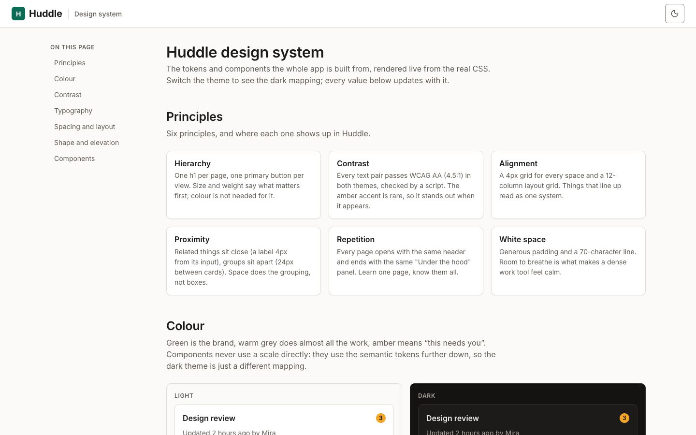

# Huddle design system

The single source is [`src/styles/tokens.css`](src/styles/tokens.css). Components use only the semantic tokens, never a raw colour (a unit test fails if a hex value appears in any other stylesheet). The living reference is **`/styleguide`** in the app: every value there is read from the real CSS at run time, so it cannot drift from the code.

## 1. Principles

| Principle | The rule in Huddle |
|---|---|
| Hierarchy | One `h1` per page, in the same place; one primary button per view. Size and weight carry importance; colour is not needed for it. |
| Contrast | Every text pair passes WCAG AA (4.5:1) in both themes, checked by a script. The amber accent is rare, so it stands out when it appears. |
| Alignment | Every space is on a 4 px grid; layout uses a 12-column grid; cards in a row are the same height. |
| Proximity | Related things are close (a label 4 px above its input), groups are apart (24 px between cards). Space does the grouping, not boxes. |
| Repetition | Every page: the same header, the same row pattern, the same empty state, the same "Under the hood" panel at the end. |
| White space | Generous padding, lines no longer than about 70 characters. |

## 2. Colour

### Why these colours

- **Green is the brand**, kept from Day 17 (`#0E9F6E` is `--green-500`) so Huddle still looks like Huddle. Small text needs a darker green: `--green-700` carries white text at 6.47:1.
- **Warm grey does almost all the work** (surfaces, borders, text). Greys with a little yellow sit calmly next to green; the cool blue-greys Day 17 used fought it.
- **One accent, amber**, from the warm side opposite green, kept for exactly one meaning: **this needs you** (unread mentions, the "Needs you" card, the bell's count). Used sparingly so it keeps its pull.
- **Red** only for errors and destructive actions. **Blue** for information, @mentions, and the **focus ring**: a hue nothing else uses, so focus is never mistaken for a state.
- **Information is never colour alone:** an unread room is bold *and* shows a number; an error is red *and* has an icon and text; links in running text are underlined.

### Scales (primitives)

| Scale | 50 | 100 | 200 | 300 | 400 | 500 | 600 | 700 | 800 | 900 | 950 |
|---|---|---|---|---|---|---|---|---|---|---|---|
| Green | `#ecf8f2` | `#d3f0e2` | `#a6e3c8` | `#6fd0a9` | `#3fbe8e` | **`#0e9f6e`** | `#0c8763` | `#0b6b54` | `#0a5544` | `#11352b` | `#0a2219` |
| Amber | `#fff6e5` | `#feeacc` | `#fdd594` | `#fbbf5c` | **`#f5a524`** | `#dd8a0b` | `#b86b05` | `#8a4b00` | `#6b3a08` | `#4f2b07` | `#352812` |

Warm grey: `0 #ffffff` · `25 #fbfaf8` · `50 #f4f2ef` · `100 #eeece8` · `200 #e2dfda` · `300 #ccc8c1` · `400 #a9a39c` · `500 #857f78` · `600 #5f5a54` · `700 #45413c` · `800 #2e2b28` · `850 #262421` · `900 #1c1b19` · `925 #181715` · `950 #141312`

Red: `50 #feeeec` · `100 #fddad5` · `300 #ff8a7a` · `500 #c8372a` · `600 #b42318` · `700 #8f1c13` · `900 #3a1c18`
Blue: `50 #eaf1fe` · `200 #b9d1ff` · `300 #8ab4ff` · `400 #6ea8ff` · `600 #2563eb` · `700 #1e4fb8` · `800 #1e3157` · `900 #172742`

### Semantic tokens (what components use)

| Token | Purpose | Light | Dark |
|---|---|---|---|
| `--color-bg` | the page | grey 25 | grey 950 |
| `--color-bg-subtle` | sidebar, code, wells | grey 50 | grey 925 |
| `--color-surface` | cards, inputs | white | grey 900 |
| `--color-surface-raised` | menus, toasts | white | grey 850 |
| `--color-border` | dividers (decoration) | grey 200 | grey 800 |
| `--color-border-input` | control edges, 3:1 (WCAG 1.4.11) | grey 500 | grey 500 |
| `--color-text` | everything you read | grey 900 | grey 100 |
| `--color-text-secondary` | dates, hints, meta | grey 600 | grey 400 |
| `--color-primary` / `--color-on-primary` | primary button | green 700 / white | green 700 / white |
| `--color-primary-text` | links | green 700 | green 300 |
| `--color-selected` / `-text` | current page, selected row | green 50 / 800 | green 900 / 200 |
| `--color-attention` / `--color-on-attention` | unread and mention counts | amber 400 / grey 900 | amber 400 / grey 900 |
| `--color-success-text`, `--color-warning-text`, `--color-danger-text`, `--color-info-text` | status | green 700, amber 700, red 600, blue 700 | green 300, amber 300, red 300, blue 300 |
| `--color-focus` | focus ring | blue 600 | blue 400 |

**Only two text greys.** Fewer greys make a clearer hierarchy, and both pass AA on every surface.

**The dark theme is a mapping, not an inversion.** Surfaces get *lighter* as they come forward (a shadow can not be seen on black), colours become lighter tints so they keep their contrast, and text is off-white (pure white glares).

Themes are scoped by `[data-theme]`, not only `:root`, so a part of a page can show the other theme (the style guide renders both side by side). The theme follows the operating system until you choose one, and is set before the first paint (no white flash).

### Contrast, measured

`npm run contrast` resolves every `var()` for each theme and scores **34 pairs × 2 themes**: all 68 pass. The lowest text pairs are 5.78:1 (light) and 5.20:1 (dark), against the 4.5:1 minimum. Full table: [docs/contrast.md](docs/contrast.md). The same function runs in the unit tests and live on `/styleguide`. Adding a colour means adding its pairs to `CONTRAST_PAIRS` in `src/lib/contrast.js`; the test then fails until it passes.

## 3. Typography

- **Inter** for the interface: designed for screens (tall x-height, open shapes, tabular figures). The `cv05` feature gives lowercase l a tail, so l, I and 1 never look alike in usernames and share links.
- **JetBrains Mono** for code in the Query lab and the "Under the hood" panels.
- One family for everything you read keeps the interface calm; hierarchy comes from size and weight.
- Both fonts are **self-hosted** (npm `@fontsource-variable`), so there are no Google Fonts requests and the tests run offline.

### Scale: ratio 1.25 (major third) from 16 px, in rem

| Token | Size | Used for |
|---|---|---|
| `--text-3xl` | 39 px | the sign-in pitch |
| `--text-2xl` | 31 px | page titles (`h1`) |
| `--text-xl` | 25 px | page titles on a phone |
| `--text-lg` | 20 px | section and card titles (`h2`) |
| `--text-md` | 16 px | body text, inputs (16 px also stops iOS zooming on focus) |
| `--text-sm` | 14 px | navigation, labels, buttons, meta |
| `--text-xs` | 12 px | badges, counts, captions |

Line height 1.5 for body text, 1.2 for headings, 1.35 for UI labels. Weights 400, 500, 600, 700. Letter-spacing only on large headings (`-0.011em`) and small uppercase labels (`0.06em`). Sizes are in **rem**, so they follow the reader's text-size setting (tested at 200%).

## 4. Spacing, layout, shape

| Token | Value | Typical use |
|---|---|---|
| `--space-1` | 4 px | icon to its label |
| `--space-2` | 8 px | inside a group, chips |
| `--space-3` | 12 px | list rows |
| `--space-4` | 16 px | card padding on a phone, form fields |
| `--space-6` | 24 px | card padding, gaps between cards |
| `--space-8` | 32 px | between page sections |
| `--space-12` | 48 px | large breaks |
| `--space-16` | 64 px | the sign-in panels |

- **Layout:** a 12-column grid (`.grid-12`, spans from 40 em and 60 em), mobile first. Breakpoints: base = phone, **40 em (640 px)**, **60 em (960 px, the sidebar appears)**, **80 em (1280 px, chat's details panel moves to the side)**.
- **Radius:** 4 px (inline code, badges), 6 px (buttons, inputs), 10 px (cards, menus), full (pills, avatars).
- **Elevation:** four soft shadows tinted with the text colour, not black; in dark mode lighter surfaces do the job.
- **Motion:** 120 / 200 / 320 ms with an ease-out curve; all set to 0 when the system asks for reduced motion (tested).
- **Targets:** controls are 40 px tall by default, never under 24 px (WCAG 2.5.8).

## 5. Components ([`components.css`](src/styles/components.css))

| Component | Notes |
|---|---|
| Buttons | primary (one per view), secondary (default), ghost (toolbars), danger and danger-solid; 40 px and 32 px; hover, active, focus-visible, disabled (`disabled` or `aria-disabled`, which keeps focus) |
| Icon buttons | always with `aria-label` |
| Fields | visible label above, hint and error tied with `aria-describedby`; an error is text plus an icon, never only a red border; 16 px input text |
| Checkboxes | 20 px box, the label (which toggles it) at least 24 px tall |
| Cards, page header | one header pattern for every page: `h1`, one line of context, the actions |
| Rows | a list of things to open: icon, title link stretched over the whole row (one big target, a short accessible name), a detail line, a time |
| Badges, counts, chips | amber counts mean "needs you" only; a count always shows its number; filter chips are toggle buttons (`aria-pressed`), active filters are removable chips |
| Alerts, toasts | inline messages for the page; toasts confirm an action and are announced through live regions that are always present |
| Empty state | what is missing, why, and the one next step |
| Under the hood | the Day 17 developer notes, collapsed, in the same place on every page (a native `
`) |

React helpers: `PageHeader`, `EmptyState`, `UnderTheHood`, `RelativeTime` ("2 hours ago", exact date on hover and in `dateTime`), `CountBadge` (the number for the eye, words for screen readers).

## 6. Patterns

- **F-pattern (dashboard):** the eye starts top left, so "Needs you" is there; it then runs down the left column (notes, files); the right column holds what is useful but secondary (numbers, quick actions).
- **Z-pattern (sign-in):** brand top left, the pitch across, ending on the form and its button on the right, which is where the page wants the eye to end.
- **Mobile first:** every stylesheet starts with the phone layout and adds columns as space allows. The app shell is one DOM with two layouts (a sidebar, or a bar with a disclosure menu).

## 7. Adding to the system

1. A new colour: add the primitive if needed, then a **semantic** token in both theme blocks, then its pairs in `CONTRAST_PAIRS`. Run `npm test`.
2. A new component: build it from tokens only, give it hover, focus-visible, disabled and error states, and add it to `/styleguide`.
3. A new space: don't. If none of the eight steps fits, the layout is probably the problem.
