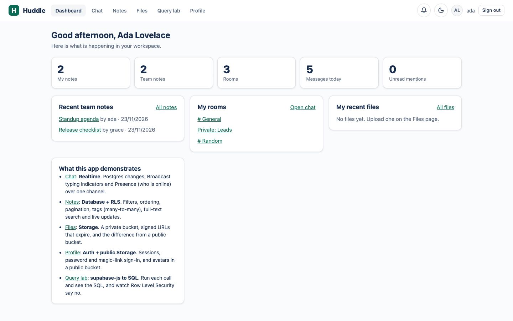
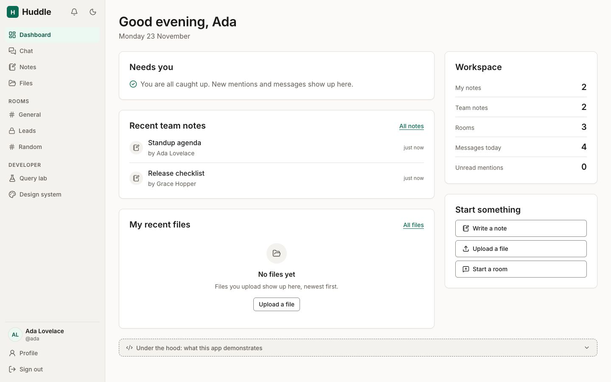

# Huddle, redesigned

**Day 22 project:** Linkific Month 1 Training · UI/UX design principles for developers
**Author:** Ronit Ahuja
**Based on:** [Day 17's Huddle](../../Day-17/huddle) (a team workspace on Supabase), copied here and redesigned; the database, the API calls and the features are unchanged.
**Stack:** React 19, Vite, supabase-js, local Supabase; Inter and JetBrains Mono (self-hosted); Vitest, Playwright, axe-core, pgTAP
**PRD:** [Day22_PRD.md](../Day22_PRD.md) · **Design system:** [DESIGN.md](DESIGN.md) · **Accessibility audit:** [ACCESSIBILITY_AUDIT.md](ACCESSIBILITY_AUDIT.md) · **Before/after:** [docs/GALLERY.md](docs/GALLERY.md)

Day 17 built Huddle fast to learn Supabase; styling was an afterthought. Day 22 redesigns it with real design principles, makes it accessible to WCAG 2.2 AA, and backs every claim with evidence a script produced: contrast ratios, screenshots, measurements and tests.

| Before (Day 17) | After (Day 22) |
|---|---|
|  |  |

## What the brief asked for, and where it is

| Deliverable | Where |
|---|---|
| A redesigned application | this folder: every page, light and dark, desktop and phone ([gallery](docs/GALLERY.md)) |
| Figma file for one component (optional) | skipped by choice: the design source is code. The living style guide at **`/styleguide`** renders every token and component from the real CSS, in both themes ([screenshot](docs/screenshots/styleguide-light.jpg)) |
| Accessibility audit with fixes | [ACCESSIBILITY_AUDIT.md](ACCESSIBILITY_AUDIT.md): 14 findings with WCAG criterion, severity, fix and how it is verified; measurements [before](docs/audit/before.md) and [after](docs/audit/after.md) |
| Colour palette and typography documentation | [DESIGN.md](DESIGN.md), and [docs/contrast.md](docs/contrast.md) (every colour pair, generated) |
| Before/after screenshots | [docs/GALLERY.md](docs/GALLERY.md): 20 views, same pages, same data, same sizes, taken by [a script](scripts/screenshots.mjs) |
| README explaining the design decisions | this file |

## Design decisions, principle by principle

| Principle | The problem on Day 17 | What changed |
|---|---|---|
| **Visual hierarchy** | Developer explanations ("How this page works") competed with the product on every page; five equal stat tiles; one size for everything | One `h1` per page in the same place; the explanations are collapsed in one "Under the hood" panel at the end of each page; the dashboard leads with what needs you, and the numbers became a quiet list |
| **Contrast** | Every list item an underlined link; no difference between primary and secondary actions | One primary button per view; secondary, ghost and danger buttons; links underlined only in running text; every text pair at least 4.5:1, measured ([contrast](docs/contrast.md)) |
| **Alignment** | Cards of uneven height left holes; ad-hoc pixel values | A 4 px spacing grid with eight steps, a 12-column layout, equal-height cards with their footers on the bottom edge |
| **Proximity** | Notes: six filters in a big panel, search far from "New note"; the chat room list floated loose | One toolbar (search + More filters), quick filter chips that apply at once, the active filters as removable chips; rooms as one list with their unread count on the row |
| **Repetition** | Every page laid out differently | The same page header, row pattern, empty state and "Under the hood" panel everywhere; one sidebar |
| **White space** | Dense blocks, no maximum line length | Generous card padding (16 px phone, 24 px desktop), 70-character lines, 24 px between cards |
| **Colour** | One green plus greys; nothing said "this needs you" | Green stays the brand; warm greys do the work; one **amber accent**, kept for mentions and "needs you", so it keeps its pull; status colours for success, warning, danger, info; a real dark theme |
| **Typography** | System font at ad-hoc sizes | **Inter** (built for screens; `cv05` so l, I and 1 differ) and **JetBrains Mono** for code; a 1.25 type scale (12 to 39 px) in rem |
| **Reading patterns** | The useful information was not where the eye lands | Dashboard laid out for an **F-pattern** (Needs you top left); sign-in a **Z-pattern** split (brand, pitch, then the form and its button) |
| **Mobile first** | On a phone the header wrapped into three rows before any content | One 56 px bar with a Menu button; the sidebar becomes a disclosure panel; chat becomes two screens (rooms, conversation) |

The full system (every token, why it exists, how to add one) is in [DESIGN.md](DESIGN.md).

## The redesign, page by page

- **App shell:** a sticky sidebar on wide screens (pages, my rooms with live unread counts, developer tools, me); a one-row bar with a disclosure menu on phones; skip link; focus moves to the new page's heading on every page change.
- **Dashboard:** "Needs you" (unread mentions with a quote, rooms with new messages, or "all caught up"), recent team notes and my files with names and relative times, a quiet "Workspace" list, "Start something".
- **Chat:** `/chat` is a room browser (search, your rooms, public rooms, New room); a room is a full-width conversation, oldest first, grouped by author, with the composer at the bottom and an About / Online now panel.
- **Notes:** search and More filters in one toolbar; chips for All / Mine / Team / Private / Pinned; equal-height cards; "No notes yet" and "No notes match" are different states.
- **Files, Profile, Query lab:** the same header, cards and panel; the bucket demo and the SQL notes live under the hood.
- **Sign-in, register, reset:** a split layout, the pitch on brand green and the form on the right; one line above the form on a phone.

## Accessibility

Huddle already passed axe's WCAG 2.1 rules on Day 17; the real problems were in the 2.2 rules and in what only a person or a script measuring the page finds. The [audit](ACCESSIBILITY_AUDIT.md) lists 14 findings, each fixed (or closed as a false positive) and each covered by a test:

| | Day 17 design | Now |
|---|---|---|
| axe, WCAG 2.2 AA, light and dark | 1 rule failing (chat) | **0**, also with a room, forms, filters and the notification panel open |
| Sideways scrolling at 320 px | Files | **none** (every page tested) |
| Targets under 24×24 px | links 23 px, checkboxes 16 px | **none** |
| Tab stops before the content on a phone | 11 | **4** |
| Focus after a failed sign-in / after choosing a page | lost / left on the link | stays on the button / the new page's heading |
| Colour pairs checked | none | **68, all AA** |

Also tested: text at 200%, `prefers-reduced-motion`, keyboard-only flows, and ARIA snapshots of the accessibility tree. **Not yet done:** a VoiceOver pass by a person ([script](docs/VOICEOVER_CHECK.md)); NVDA and JAWS (Windows) were not tried.

## Run it (local Supabase, no account needed)

You need Node 20+, Docker (Docker Desktop, or Colima on a Mac) and about 4 GB of memory for the containers.

```bash
cd Day-22/huddle-redesign
npm install
npm run db:start      # starts Postgres, Auth, REST, Realtime, Storage and a mail catcher; applies the migrations and the seed
npm run env:local     # writes .env with the local API URL and the public anon key
npm run dev           # http://localhost:5177 (the style guide: /styleguide)
```

- The demo accounts are `ada@example.com` and `grace@example.com`, password `demo-password-123` (they exist only in the local seed).
- Emails (sign-up confirmation is off locally; magic links and password resets are sent) land in the mail catcher at http://127.0.0.1:54324.
- `npm run db:reset` wipes the database and re-applies the migrations and the seed. `npm run db:stop` stops the containers.
- The Studio dashboard, log collection, image transforms and edge functions are not started (`-x` in `db:start`) to keep the stack small.

### Use a Supabase cloud project instead

1. Create a project at supabase.com (free tier).
2. `npx supabase login`, then `npx supabase link --project-ref <your-ref>`.
3. `npx supabase db push` applies the migrations (the seed is **not** applied to a cloud project).
4. Copy the project URL and the **anon / publishable** key (Project settings, API) into `.env` as `VITE_SUPABASE_URL` and `VITE_SUPABASE_ANON_KEY`. Never use the `service_role` / secret key in the browser.
5. Authentication, URL configuration: set the Site URL to where the app runs and add `/auth/callback` and `/auth/reset` to the redirect URLs. Turn on Email confirmations if you want them.
6. Realtime is enabled by the last migration (the `supabase_realtime` publication). Storage buckets are created by the migration too.

### Turn on Google or GitHub sign-in

The buttons appear only when the server has the provider enabled (the app reads `/auth/v1/settings`).

1. Create an OAuth app at the provider. Callback URL for local development: `http://127.0.0.1:54321/auth/v1/callback`. For a cloud project it is `https://<ref>.supabase.co/auth/v1/callback`.
2. Local: copy `supabase/.env.example` to `supabase/.env`, fill in the id and secret, set `enabled = true` for the provider in `supabase/config.toml`, then `npx supabase stop && npm run db:start`.
   Cloud: Authentication, Sign in / Providers in the dashboard.
3. The secrets live in `supabase/.env` (git-ignored) or in the dashboard, never in the repo.

**Not verified here:** a real Google or GitHub sign-in (it needs your own OAuth app). The flow up to the provider redirect, and the callback handling, are tested; the provider's own consent screen is not.

## How it works (the Supabase side, unchanged from Day 17)

```
Browser (React + supabase-js)  ──HTTP──►  Kong gateway ──► GoTrue   (sign-up, sign-in, magic link, OAuth)  issues a JWT
   anon key + the user's JWT                           ├─► PostgREST (from().select()/insert()/rpc())     runs SQL AS the user
                                                       ├─► Storage   (upload, signed URLs)                 policies on storage.objects
                              ──WebSocket──►  Realtime (postgres_changes, Broadcast, Presence)  reads the WAL, filters with RLS
                                                              all of it ──► PostgreSQL 17 (the one source of truth)
```

The browser only ever holds the **anon key** (public) and the signed-in user's **JWT**. PostgREST puts the JWT's claims into the Postgres session, so `auth.uid()` inside a policy is the signed-in user. That is why the security rules live in the database and a client cannot get around them.

### Schema (9 tables)

`profiles` (one per auth user, created by a trigger), `notes`, `tags`, `note_tags` (many to many), `files`, `rooms`, `room_members`, `messages`, `notifications`.

- **Generated columns:** `rooms.slug` (from the name) and `notes.fts`, a `tsvector` with a GIN index for full-text search.
- **Indexes:** composite (`owner_id, created_at desc`), partial (pinned notes only, unread notifications only), GIN for search, and foreign-key indexes.
- **Constraints:** `check` on username format and priority range, unique `(owner_id, name)` for tags, `on delete cascade` for everything owned by a user.

### Row Level Security

| Table | Who can do what |
|---|---|
| `profiles` | everyone signed in reads; only the owner updates (a trigger creates it, so there is no insert policy) |
| `notes` | read my own and `team` ones; write only my own |
| `tags`, `note_tags` | read all tags; I manage my own tags and links on my own notes |
| `files` | I manage mine; room members read files attached to messages they can see |
| `rooms`, `room_members` | public rooms are readable and joinable; private rooms only by members |
| `messages` | read and send in rooms I can access; edit and delete only my own |
| `notifications` | read mine; the client may only set `read_at` (column-level privilege); the rows are created by a trigger |
| `storage.objects` | `avatars` public to read, write only under my own folder; `attachments` private, owner or room member |

Two tricks to know: policies are written `(select auth.uid())` so Postgres evaluates it once per query, not once per row; and policies that look into another table which itself has policies (for room membership) go through `security definer` helper functions, otherwise Postgres reports infinite recursion.

### Functions and triggers

| Name | Kind | What |
|---|---|---|
| `handle_new_user` | trigger on `auth.users` | creates the profile from the sign-up metadata |
| `add_room_creator` | trigger | the creator becomes a member of their new room |
| `notify_mentions` | trigger on `messages` | `@username` in a message creates a notification |
| `set_updated_at`, `mark_message_edited` | triggers | bookkeeping columns |
| `search_notes(q)` | RPC | `websearch_to_tsquery`, `ts_rank`, `ts_headline` (marks matches with `[[ ]]`, not HTML) |
| `unread_counts()`, `mark_room_read(room)` | RPC | unread badges |
| `workspace_stats()` | RPC | the dashboard numbers in one round trip |
| `is_room_member`, `can_access_room` | `security definer` helpers | used by policies to avoid recursion |

The RPCs are `security invoker`: they run with the caller's rights, so RLS still applies inside them (a search never returns someone's private note).


## Scripts (Day 22)

```bash
npm run contrast                          # every token pair, light and dark, against WCAG AA; writes docs/contrast.md; exits 1 on a failure
node scripts/audit.mjs after              # axe + the measurements axe does not make; writes docs/audit/after.md (dev server running)
node scripts/screenshots.mjs after        # the 20 gallery views; run npm run db:reset first so the data matches
```

## Tests

```bash
npm test                 # 310 unit and component tests (fake supabase client), including the contrast gate
npm run db:test          # 77 pgTAP assertions inside the real database
npm run test:e2e         # 75 browser tests against the real local stack
npm run lint
```

| Layer | What |
|---|---|
| Unit / component | every page and component, the shell (landmarks, menu, focus after navigation), the design tokens (every pair passes AA; no raw colours outside `tokens.css`; every token the style guide shows exists), toasts are shown **and** announced |
| Database (pgTAP) | policies for several users and `anon`, triggers, constraints, RPCs, storage policies |
| Browser (Playwright, Chrome) | everything from Day 17 (two browsers chatting live, notes, uploads, 15 direct API attacks that must be refused) plus: axe WCAG 2.2 AA on every page and on states behind a click in both themes, tab order with a visible focus ring on every stop, the skip link, the phone menu, 320 px reflow, text at 200%, reduced motion, keyboard-only flows, ARIA snapshots, the style guide |

## Problems the redesign found (and fixed)

- **Chat looked newest-first, but was not.** The list was built oldest first; the seed inserted its messages in one statement, so they shared a timestamp, and the query had no tie-breaker. Fixed with `.order('id')` and realistic seed times.
- **Focus was lost after a failed sign-in.** The submit button was `disabled` while busy, and disabling the focused element sends focus to `<body>`. Buttons now stay focusable (`aria-disabled`) with a guard against double submits.
- **Screen readers met two "Attach a file" buttons**: the hidden file input was in the accessibility tree. Now `aria-hidden`.
- **Toasts were not reliably announced**: a live region created together with its text is often not read. They now go through live regions that are always on the page.
- **Hidden screen-reader text widened the page on phones**: absolutely positioned `.sr-only` text escaped a scrolling table. The scroller is now `position: relative`.
- **A session the server had ended was only noticed at the next reload.** After the account was deleted (a local `supabase db reset` did it to a real sign-up), the page still acted signed in and the avatar upload showed PostgREST's raw "Cannot coerce the result to a single JSON object". The app now asks the Auth server again when you come back to the tab and after a "no such row" error, signs out, and the sign-in page says why. (Day 17's start-up check had only worked because supabase-js signs out by itself for one of the two cases.)
- **A Day 17 test failed now and then**: it advanced a fake clock before the countdown's timer existed. It now waits for it.

## Limits

- The VoiceOver pass is written but not yet run; only Chrome was tested, and no real phone (the phone checks are Chrome viewports).
- No Figma file (the brief made it optional; the style guide is the design reference).
- Day 17's limits still apply: OAuth providers unverified, Realtime is not guaranteed delivery, file deletion is two calls, local seed and relaxed rate limits only.
