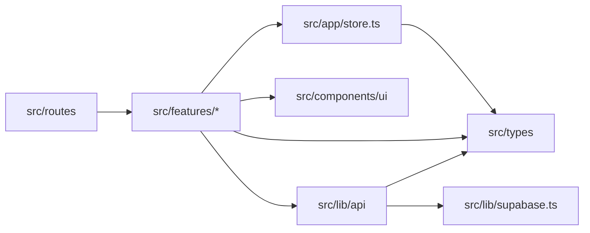

# Architecture Spine — SkillForge LMS

## Design Paradigm

**Feature-Sliced SPA + Authoritative Postgres/RLS Backend:**
- UI & domain state live in `src/features/<domain>/` (co-locating Redux Toolkit slices, feature components, and domain hooks).
- Data access flows exclusively through typed API adapters in `src/lib/api/` backed by `@supabase/supabase-js`.
- Security invariants, quiz grading, and certificate issuance execute in Supabase Postgres (RLS + `SECURITY DEFINER` RPCs) — never trusted to browser state.

## Invariants & Rules

### AD-1 — Unidirectional Dependency Direction [ADOPTED]
- **Binds:** all
- **Prevents:** circular imports between Redux slices, shared components, and Supabase adapters.
- **Rule:** `routes/` -> `features/` -> `components/ui/` + `lib/` + `types/`. Components never import `@supabase/supabase-js` directly; all network calls pass through `src/lib/api/` or feature thunks.



### AD-2 — Typed Redux Toolkit Owns Shared Domain State [ADOPTED]
- **Binds:** FR-1, FR-4, FR-5, FR-7..FR-12, FR-17..FR-21
- **Prevents:** split source of truth between Context providers and ad-hoc component `useState` fetches.
- **Rule:** Global domain state (`auth`, `catalog`, `player`, `quiz`, `instructor`, `ui`) lives in `configureStore` using `createSlice`/`createAsyncThunk` and typed hooks (`useAppDispatch`, `useAppSelector`). Form drafts and dropdown open/close toggles remain local component state.

### AD-3 — Strict TypeScript with Zero `any` [ADOPTED]
- **Binds:** all
- **Prevents:** runtime undefined crashes from unvalidated Supabase rows or untyped Redux payloads.
- **Rule:** `tsconfig.json` enforces `strict: true`, `noUncheckedIndexedAccess: true`, and `allowJs: false`. `.oxlintrc.json` sets `typescript/no-explicit-any: error`.

### AD-4 — Authoritative Quiz Grading via Postgres RPC
- **Binds:** FR-11, FR-12
- **Prevents:** learners inspecting network responses or Redux payloads to read `correct_option_index` or forge passing scores.
- **Rule:** Direct `SELECT` policies on `quiz_questions` are restricted to course instructors or served via a student-safe view/RPC omitting `correct_option_index` until submission. `submit_quiz_attempt(p_quiz_id, p_answers)` computes `score_percent` and `passed` inside Postgres.

### AD-5 — Tamper-Resistant Certificate Issuance
- **Binds:** FR-14, FR-15
- **Prevents:** generating fake completion certificates without finishing lessons and quizzes.
- **Rule:** `claim_course_certificate(p_course_id)` verifies `100%` `lesson_progress.is_completed` across published course lessons and passing `quiz_attempts` before inserting into `certificates` with a unique `certificate_code`.

### AD-6 — Debounced Video Progress Persistence
- **Binds:** FR-8, FR-9, FR-10
- **Prevents:** excessive Postgres writes every second during video playback while avoiding lost watch positions.
- **Rule:** `playerSlice` tracks local playback seconds smoothly in memory and flushes `upsert_lesson_progress` every `10s`, plus immediately on pause, lesson switch, or `pagehide`.

### AD-7 — Role-Based RLS on All Tables & Storage
- **Binds:** FR-1..FR-3, FR-18, FR-20
- **Prevents:** students modifying courses or reading another student's private quiz attempts.
- **Rule:** Every table enables Row Level Security. `courses`/`modules`/`lessons` allow public read when `courses.status = 'published'` (or `instructor_id = auth.uid()`); writes require matching `instructor_id` or `admin` role. `enrollments`, `lesson_progress`, and `quiz_attempts` are readable/writable only by their `user_id` (plus aggregate read for course instructor).

### AD-8 — Performance & Lazy Route Boundaries
- **Binds:** Cross-Cutting NFRs
- **Prevents:** bloating the initial bundle with Recharts or heavy player/editor code on the landing/catalog route.
- **Rule:** `LessonPlayerPage`, `QuizPage`, `InstructorDashboard`, and `CourseBuilderPage` are loaded via `React.lazy` inside `<Suspense>` route wrappers.

## Consistency Conventions

| Concern | Convention |
| --- | --- |
| Naming | Components `PascalCase.tsx`; slices `<domain>Slice.ts`; hooks `use<Name>.ts`; SQL snake_case |
| IDs & Dates | UUID primary keys (`gen_random_uuid()`), ISO-8601 UTC timestamps (`timestamptz`) |
| Error Handling | Thunks normalize errors to `{ code: string; message: string }` for accessible inline alerts and toasts |
| Auth & Env | Only `VITE_SUPABASE_URL` and `VITE_SUPABASE_ANON_KEY` in client bundle |

## Stack

| Name | Version |
| --- | --- |
| React / React DOM | 19.3.x |
| Vite | 8.3.x |
| TypeScript | ~5.9.0 |
| Tailwind CSS / `@tailwindcss/vite` | 4.3.x |
| Redux Toolkit / React Redux | 2.15.x / 9.3.x |
| React Router DOM | 7.18.x |
| Supabase JS / Supabase CLI | 2.119.x / 3.2.x |
| Recharts | 3.10.x |
| Vitest / `oxlint` / Prettier | 4.1.x / 1.93.x / 3.9.x |

## Structural Seed

```text
Day-25/skillforge-lms/
  src/
    app/          # store.ts, hooks.ts
    components/   # layout/ (AppShell), ui/ (Button, Badge, Card, Modal)
    features/     # auth, catalog, player, quizzes, certificates, dashboard, instructor, reviews
    lib/          # supabase.ts, api/
    routes/       # AppRouter.tsx, ProtectedRoute.tsx
    styles/       # index.css (Tailwind v4 + tokens)
    types/        # lms.ts
  supabase/
    migrations/   # 0001_initial_schema.sql
    seed.sql
  test/           # Vitest unit & component tests
```

## Deferred

- **Stripe Checkout & Webhooks:** Deferred beyond v1 capstone; schema can add `price_cents` and `orders` without altering enrollment/progress tables.
- **Server-Side Video Transcoding:** Deferred; v1 uses direct MP4/WebM uploads to Supabase Storage or embedded video URLs.
