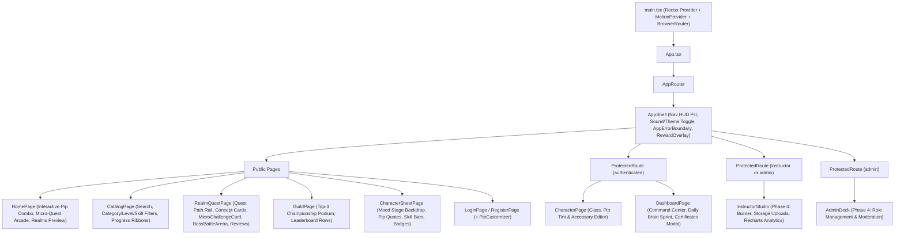
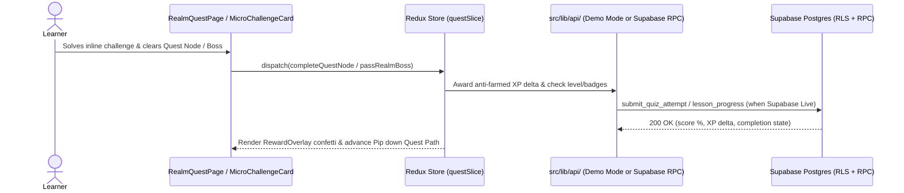
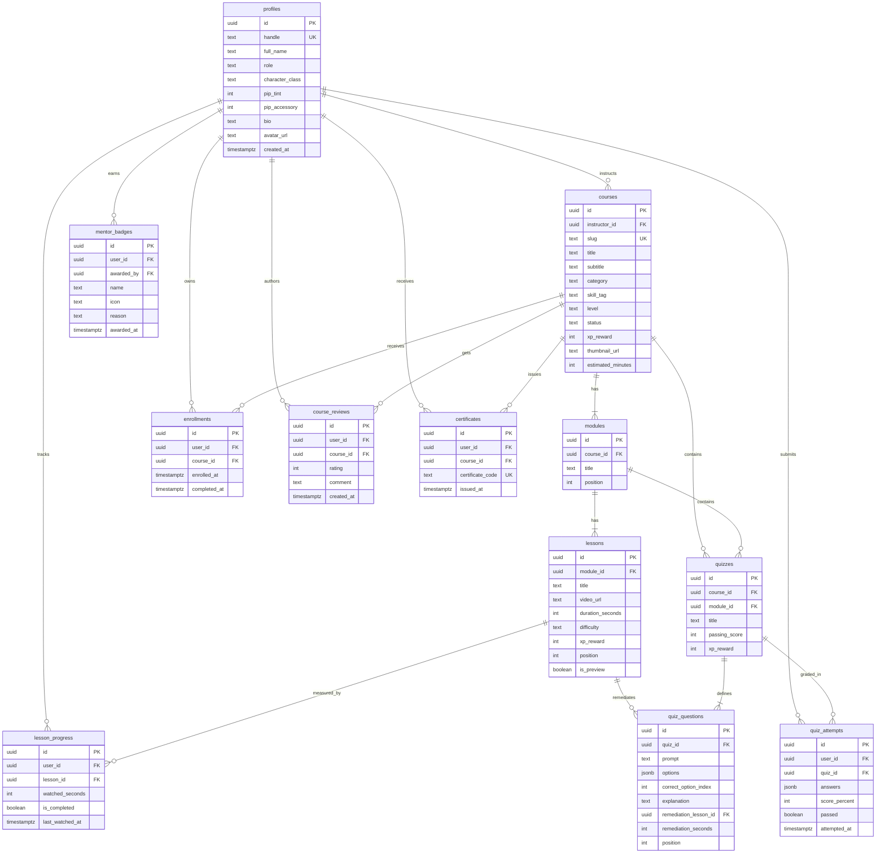

# Technical Architecture — SkillForge LMS

This document details the component hierarchy, Redux Toolkit state management flow, Supabase API/RPC integration plan, and Postgres database schema for **SkillForge LMS**.

---

## 1. Component Architecture Diagram



### Folder Organization (`Day-25/skillforge-lms/src/`)

```text
src/
  app/
    store.ts              # configureStore combining auth, catalog, guild, quest, ui slices
    hooks.ts              # Typed useAppDispatch & useAppSelector
  components/
    AppErrorBoundary.tsx  # Route-level React Error Boundary with reload action
    MotionProvider.tsx    # LazyMotion (domMax async chunk) + reducedMotion="user"
    game/                 # CountUpValue, FloatingParticles, MicroChallengeCard, RewardOverlay
    layout/               # AppShell (HUD nav pill, sound/theme toggles, toast & reward portal)
    pip/                  # Animated Pip SVG (Egg -> Guardian) & PipCustomizer
  features/
    auth/                 # authSlice.ts, LoginPage, RegisterPage, CharacterPage
    catalog/              # catalogSlice.ts, CatalogPage
    dashboard/            # DashboardPage (Command Center + Certificate preview)
    guild/                # guildSlice.ts, GuildPage (Podium), CharacterSheetPage
    home/                 # HomePage (Pip Combo Hero + Instant Micro-Quest Arcade)
    quest/                # questSlice.ts, RealmQuestPage (Quest Path + Boss Battle + Reviews)
    ui/                   # uiSlice.ts (theme mode, Web Audio sound toggle, toast queue)
  lib/
    api/                  # authApi.ts, catalogApi.ts, guildApi.ts
    game/                 # xp.ts, badges.ts, pip.ts, catalog.ts, sfx.ts
    demoCurricula.ts      # Playable realm modules, slides, challenges & boss questions
    demoData.ts           # Seeded adventurers & course realms for zero-Docker Demo Mode
    supabase.ts           # Lazy-validated Supabase client singleton
  routes/
    AppRouter.tsx         # Route table
    ProtectedRoute.tsx    # Role-based route guard (student / instructor / admin)
  styles/
    index.css             # Tailwind CSS v4 + Plum/Violet/Gold light & dark semantic tokens
  types/
    lms.ts                # Shared strict TypeScript domain interfaces
```

---

## 2. State Management Flow (Redux Toolkit + Supabase)



### Slice Ownership Matrix

| Slice | Owns | Key Thunks / Actions |
| --- | --- | --- |
| `authSlice` | `userId`, `email`, `profile`, `mode`, `status` | `hydrateAuth`, `signInWithEmail`, `signUpUser`, `signInWithGithub`, `saveProfile`, `signOutUser` |
| `catalogSlice` | `realms`, `filters` (`query`, `category`, `level`, `skillTag`, `sort`), `status` | `fetchRealms`, `setCatalogQuery`, `setCatalogCategory`, `setCatalogLevel`, `resetCatalogFilters` |
| `guildSlice` | `entries`, `status`, `error` | `fetchGuildLeaderboard` |
| `questSlice` | `enrolledCourseIds`, `completedLessonIds`, `passedQuizCourseIds`, `claimedCertificateIds`, `arcadeSolvedIds`, `sessionEarnedXp`, `activeReward` | `enrollInRealm`, `completeQuestNode`, `passRealmBoss`, `claimRealmCertificate`, `solveArcadeChallenge`, `addRealmReview`, `dismissReward` |
| `uiSlice` | `theme` (`light` \| `dark`), `soundEnabled`, `toasts` | `toggleTheme`, `toggleSound`, `pushToast`, `dismissToast` |

---

## 3. API & Supabase Integration Plan

| Operation | Transport | Auth / RLS Rule |
| --- | --- | --- |
| Browse & filter courses | `supabase.from('courses').select(...)` | Public read for `status = 'published'`; owner read for drafts |
| Load course detail & reviews | `courses` + `modules` + `lessons` + `course_reviews` | Published courses public; enrolled/owner sees all lesson URLs |
| Fetch Guild Hall leaderboard | `supabase.from('guild_leaderboard').select('*')` | Read-only SQL view summing lesson/quiz XP without client overrides |
| Enroll in course | `supabase.from('enrollments').insert({ course_id })` | `auth.uid() = user_id` and target course `status = 'published'` |
| Save video watch position | `supabase.from('lesson_progress').upsert(...)` | `auth.uid() = user_id` and user is enrolled in parent course |
| Fetch quiz questions (student) | `supabase.rpc('get_student_quiz_questions', { p_quiz_id })` | RPC omits `correct_option_index` and `explanation` for enrolled learners |
| Grade quiz submission | `supabase.rpc('submit_quiz_attempt', { p_quiz_id, p_answers })` | `SECURITY DEFINER` verifies enrollment, grades server-side, awards score-delta XP |
| Claim completion certificate | `supabase.rpc('claim_course_certificate', { p_course_id })` | Verifies 100% lessons completed + all course quizzes passed |
| Verify public certificate | `supabase.from('certificates').select(...).eq('certificate_code', code)` | Public read-only by `certificate_code` |
| Award mentor badge | `supabase.from('mentor_badges').insert(...)` | `is_instructor_or_admin()` verified by RLS |
| Upload thumbnail / lesson video | `supabase.storage.from('course-thumbnails' \| 'lesson-videos').upload(...)` | Folder prefix `/{userId}/...` enforced by Storage RLS policy |

---

## 4. Database Schema (Postgres ERD)


